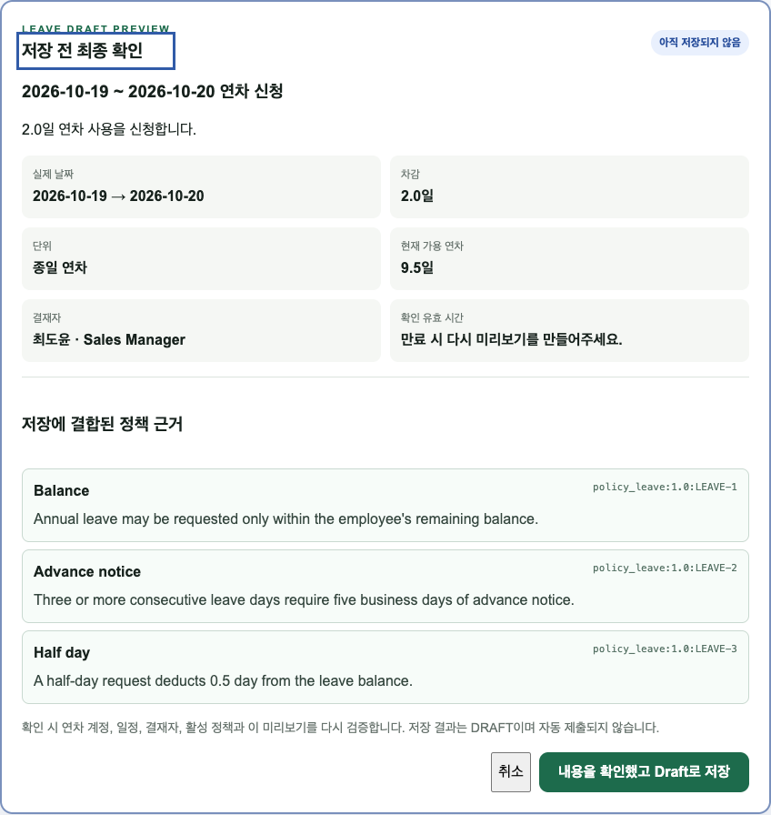

# JHWorks AI Groupware

AI-powered groupware and approval platform for the completely fictional company **JHWorks**.

JHWorks AI Groupware는 과거 회사의 제품이나 자산을 재현하지 않고, 일반적인 Enterprise workflow 문제를 바탕으로 처음부터 설계한 독립 프로젝트다. 모든 인물, 조직, 정책, 계정과 업무 데이터는 synthetic data다.

## 핵심 사용자 시나리오

> 다음 주에 이틀 휴가를 가고 싶은데, 우리 팀 업무 일정과 겹치지 않는 날짜를 찾고 휴가 결재 초안도 만들어 줘.

`자연어 요청 → 기간과 일수 구조화 → 서버의 연차/일정 계산 → 날짜 선택 → 초안 미리보기 → 명시적 저장 → DRAFT 상세`

AI는 의도를 정리하고 서버가 가능 여부, 권한과 데이터 변경을 검증한다. 초안 저장과 제출은 서로 다른 확인이며,
사용자의 확인 없이 결재 문서를 만들거나 제출하지 않는다. AI 장애 시 같은 화면의 수동 후보 탐색에서 기존 양식으로 이동한다.
기업 업무 화면을 개발한 경험을 바탕으로 API와 DB의 도메인 규칙, AI의 권한 경계를 직접 탐구한 개인 프로젝트다.

[실제 UI 스크린샷](docs/portfolio/screenshots/) | [아키텍처와 통제 근거](docs/portfolio/architecture-and-controls.md) | [작업 비교 실험 절차](docs/portfolio/task-study.md) | [이번 개선 기록](docs/portfolio/verification-2026-10-15.md)



스크린샷은 가상 데이터, 가짜 LLM/임베딩과 실제 API를 연결한 브라우저 테스트에서 촬영했다. 실제 모델 출력이나 운영 도입 증거가 아니다.

## 2026-10-23 포트폴리오 업데이트

[한영 케이스 스터디](https://pikan.dev/ko/projects/jhworks-ai-groupware) · [FDE 관점](https://pikan.dev/ko/fde/projects/jhworks-ai-groupware)

| 영역 | 구현·검증한 내용 |
| --- | --- |
| 업무 AI | 정책 RAG와 인용 검증, Structured Output, 사용자 범위 Tool, 저장·제출 각각의 확인과 멱등 처리 |
| 비공개 배포 | Cloud Run / Supabase PostgreSQL, GitHub Actions 수동 release, migration·smoke와 rollback 경로 |
| 방문자 경계 | 별도 DB schema·실행 신원·세션 키, 공간별 접근·만료·쓰기 예산, DB 공유 로그인 요청 제한 |
| 운영 증거 | 전용 demo HTTP 20개, 합성 정책·일정 검증, DB 백업과 네트워크 격리 복원의 schema/data/ACL/sequence/head 대조 |
| 자동 검증 | PR #53 CI: API 447 passed / 27 skipped, 별도 PostgreSQL 27 passed, 브라우저 16 + 2 passed |

**공개 상태:** 앱은 비공개 검증 환경이다. `groupware.pikan.dev`는 HTTPS 준비 화면이며 방문자 체험 앱은 아직 공개하지 않았다.
배포 환경의 외부 AI 호출은 비활성화했다. 정리·알림의 예약 운영과 main 자동 배포는 준비 중이다.
백업 증거는 1회 복원 리허설이며 예약 백업·운영 장애 복구 보장이나 실제 사용자 생산성 수치로 해석하지 않는다.

근거: [전용 데모 검증](docs/engineering/demo-isolated-rehearsal.md),
[합성 공용 자료](docs/engineering/demo-common-fixtures.md),
[백업·복원과 CI 기록](docs/engineering/demo-backup-profile.md),
[최신 진행 상태](docs/engineering/current-status.md), [남은 공개 단계](docs/engineering/roadmap.md).
아래 Phase 11과 2026-10-15 결과는 당시 이력이며 위의 후속 검증과 구분한다.

## Current Status

2026-10-21 로컬 재진단과 공개 배포 차단 요인은 [엔지니어링 진단](docs/engineering/assessment.md),
새 고도화 Phase 0~5의 완료 조건과 진행 상태는 [로드맵](docs/engineering/roadmap.md)에 기록한다.
아래 기존 Phase 11 완료는 외부 클라우드 운영 완료를 의미하지 않는다.

**Phase 11 — Evaluation, Guardrail, Observability, Deployment, Portfolio까지 완료했다.** 확인 기반 AI workflow 위에 통합 평가, 운영 가드레일, single-run migration, deployment smoke, release/rollback과 portfolio 증거를 완성했다.

- demo 계정 로그인과 HttpOnly session cookie
- 직원, 부서, 직속 관리자 조회
- GENERAL/BUSINESS_TRIP/LEAVE 결재 Draft 작성·수정
- 작성자 제출, 직속 관리자 승인·반려
- 반려 문서 재작성과 제출 회차 이력
- 서버 Authorization, 상태 전이, optimistic concurrency
- version과 section ID를 가진 가상 정책 원문
- FastAPI integration test와 Next.js production build 검증
- 작성자 전용 `AI로 검토하기`와 Structured Output
- 일반 코드의 필수 field·날짜·금액 검사와 LLM 의미 검토 분리
- 문서 품질 issue, 서버 계산 점수와 편집·즉시 반영 가능한 AI 수정 예시
- 문서 version 기반 stale 결과 차단
- model, prompt version, latency와 token usage 추적
- OpenAI embedding과 PostgreSQL `pgvector` 기반 정책 section 검색
- `policyId + version + sectionId`가 포함된 검증 가능한 정책 인용
- 숙박비 한도와 증빙처럼 계산 가능한 정책 rule의 결정적 검사
- 허위 citation, 추측성 risk와 중복 issue의 서버 후처리
- `READY`, `NOT_APPLICABLE`, `NOT_INDEXED`, `UNAVAILABLE` 검색 상태 표시
- 자연어 일반/출장 결재 intent 분류와 Structured Approval Draft 생성
- 누락된 출장 기간·관계처·목적·비용을 위한 여러 번의 후속 질문
- 상대 날짜를 현재 날짜와 `Asia/Seoul` 기준으로 구조화
- 저장 전 정책 근거가 포함된 exact preview와 명시적 사용자 확인
- 사용자·preview hash·만료 시간에 결합된 signed confirmation token
- 같은 confirmation 재시도에도 하나의 Draft만 만드는 idempotent 저장
- 이미 사용한 비용과 휴가 요청을 잘못된 양식으로 저장하지 않는 unsupported intent 경계
- `get_current_employee`, `get_my_manager`, `list_my_approvals`, `search_company_policy` 읽기 Tool
- OpenAI strict function schema와 서버 Pydantic argument 이중 검증
- 임의 직원 ID를 받지 않는 actor-scoped 조직·결재 조회
- 최대 3 provider rounds, 최대 4 Tool calls와 unknown Tool 차단
- 최종 답변과 실행 Tool audit, 입력 인자, 서버 결과, 정책 citation 표시
- 연도별 휴가 부여·이월·사용·대기·가용 일수 계정
- 전사 행사·공휴일·부서 프로젝트 일정·팀 휴가를 구분한 근태 캘린더
- 현재 부서 일정과 같은 팀 휴가만 반환하는 `/attendance/overview` 권한 경계
- 주말·확정 휴무일을 제외한 서버 기준 휴가 차감 일수 계산
- 휴가 제출 시 예약, 승인 시 사용 확정, 반려 시 복원되는 원자적 상태 전이
- 휴가 결재와 캘린더 이벤트의 1:1 연결 및 사유 비공개 경계
- 잔여 연차·주말·휴무일·회사 행사·프로젝트·팀 휴가를 결합한 `/attendance/leave-availability`
- 가능·주의·제외 날짜 근거와 충돌 없는 후보 우선 정렬
- 추천 후보에서 휴가 전자결재 날짜·유형을 자동 입력하는 사용자 흐름
- `Asia/Seoul` 기준 자연어 날짜·탐색 범위·희망 일수 Structured Output
- 여러 round 후속 질문과 실제 날짜가 명시된 읽기 전용 휴가 상담
- 활성 휴가 정책 RAG와 결정적 availability 결과를 분리한 grounded 설명
- 휴일·프로젝트·잔여 부족·prompt injection에서도 서버 reason code를 유지하는 경계
- 휴가 상담 provider/model/prompt version/usage/latency 관측성
- 실제 날짜·차감·단위·가용 연차·결재자·정책·주의 사유를 포함한 휴가 exact preview
- preview·사용자·candidate·account version·calendar/policy fingerprint signed confirmation
- 명시적 확인 시 연차·일정·결재자·정책을 재검증하는 actor-scoped Draft Tool
- 동일 confirmation 재시도에도 하나의 LEAVE DRAFT만 만드는 idempotency
- 상담·후속 질문·Draft 확인·제출 확인·실패 재시도를 보존하는 durable leave workflow
- Approval version·차감·가용/대기 연차·최종 결재자·주의 사유를 포함한 제출 exact preview
- Draft 저장과 분리된 두 번째 signed confirmation 뒤 기존 submit service 호출
- 제출 직전 status/version/manager/account/calendar 재검증과 stale 무변경 종료
- confirmation replay·동시 제출에서도 결재선과 연차 예약을 한 번만 만드는 idempotency
- 비밀정보와 원문 대화를 제외한 상태 transition·Tool result code trace
- 5개 실제 모델 평가를 capability별 품질 기준과 하나의 JSON report로 묶는 `eval:all`
- web→API→Agent/RAG/Tool 로그를 잇는 검증된 `X-Request-ID`
- process liveness와 DB readiness 분리, 내부 상세를 숨기는 예상 밖 오류 응답
- JSON 구조화 로그와 production JWT/cookie/PostgreSQL/HTTPS 설정 fail-fast
- prompt-like 명령을 AI 수정 예시에서 결정적으로 제거하는 출력 가드레일
- lint·type-check·test·web production build·API/web container smoke GitHub CI
- API 기동과 분리된 migration/seed release 단계 및 readiness-gated container smoke
- immutable image·DB backup·application 우선 rollback을 정의한 운영 runbook
- 아키텍처, Human-in-the-loop와 위험 통제를 연결한 portfolio evidence

휴가 Agent는 첫 번째 확인에서 DRAFT만 저장하고, 두 번째 제출 preview와 명시적 확인 전에는 제출하지 않는다. 취소·만료·stale이면 DRAFT와 연차 계정을 변경하지 않는다.

## Why This Problem

전자결재는 작성자가 목적, 일정, 금액, 세부 내역과 규정을 동시에 고려해야 한다. 정보가 모호하거나 빠지면 결재자가 문서를 반려하고 작성자와 다시 소통해야 한다.

일반 코드만으로 필수 field, 날짜, 금액과 권한은 정확하게 검증할 수 있다. 반면 업무 목적의 명확성, 의미상 누락, 자연어 요청의 구조화와 정책 문서의 관련 section 탐색은 LLM/RAG가 도움을 줄 수 있다. JHWorks AI Groupware는 두 책임을 분리하고 실제 데이터 변경은 사용자가 확인하도록 설계한다.

## Architecture

```text
Next.js web
    ↓ REST + HttpOnly cookie
FastAPI modular monolith
    ├── Authentication / Organization
    ├── Approval domain + Authorization
    ├── Company Policy + structured policy rules
    ├── Deterministic review + OpenAI adapters
    ├── Policy retrieval + citation allowlist
    ├── Natural-language draft extraction + deterministic completeness checks
    ├── Signed preview confirmation + idempotent Draft creation
    ├── Read-only enterprise tool registry + actor-scoped executor
    ├── OpenAI function calling loop + tool execution audit
    ├── Attendance calendar + yearly leave account
    ├── Transactional leave approval workflow
    ├── Deterministic leave availability engine
    ├── Grounded leave request structuring + policy RAG explanation
    ├── Actor-scoped confirmed leave Draft capability
    ├── Durable leave workflow + confirmed submit capability
    └── SQLAlchemy + Alembic
              ↓
      PostgreSQL + pgvector
```

AI Review는 관련 정책 section을 embedding search로 찾은 뒤 OpenAI Responses API와 Pydantic Structured Output으로 결과를 제한한다. AI Draft도 같은 Structured Output 경계를 사용하지만, 필수 field·날짜·비용 일관성은 서버가 다시 검사한다. 숫자 한도처럼 결정적인 정책 rule은 일반 코드가 계산한다. 휴가 workflow는 별도 framework가 아니라 application DB의 명시적 상태 머신으로 중단·재개한다.

Repository structure:

```text
apps/
├── api/   # FastAPI, domain/service, SQLAlchemy, migration, tests
└── web/   # Next.js App Router, TypeScript, minimal workflow UI
docs/
├── product/
├── code-conventions.md
CONTRIBUTING.md
```

## Approval Workflow

```text
DRAFT ──submit──> PENDING ──approve──> APPROVED
                      └────reject───> REJECTED ──revise──> DRAFT
```

- 상태를 임의로 PATCH하지 않고 submit/approve/reject/revise command를 사용한다.
- 제출 시 backend가 작성자의 현재 manager를 결재자로 계산한다.
- 반려 후 재상신은 새 ApprovalLine round를 생성해 과거 결정을 보존한다.
- 수정과 command는 문서 version을 비교해 오래된 화면의 덮어쓰기를 막는다.

## Demo Accounts

공통 비밀번호: `demo1234`

이 계정은 로컬 개발·테스트 전용이다. 기본 seed는 development/test의 SQLite 또는
localhost/loopback/로컬 Compose `db` PostgreSQL에서만 실행되며 원격 DB와 staging/production은
연결 전에 거부한다. 공개 서비스에는 이 비밀번호를 등록하지 않는다.
[실행 경계와 검증](docs/engineering/local-seed-boundary.md)을 참고한다.

| 역할 | 이메일 | 가능한 작업 |
| --- | --- | --- |
| 작성자 윤서진 | `seojin.yoon@jhworks.test` | Draft 작성·제출·재작성 |
| 결재자 최도윤 | `doyun.choi@jhworks.test` | Sales 문서 승인·반려 |
| 정책 운영 한가람 | `garam.han@jhworks.test` | 가상 정책 조회 |

이 계정은 local portfolio demo 전용이며 실제 인증 시스템을 나타내지 않는다.

## Run with Docker

Requirements: Docker Engine과 Docker Compose v2 plugin

```bash
cp .env.example .env
# .env의 JHWORKS_OPENAI_API_KEY에 본인의 API key를 입력한다.
docker compose up --build
```

Compose는 migration과 synthetic seed를 완료한 뒤 API와 web을 기동한다. 배포 계약을 확인하려면 별도 terminal에서
읽기 전용 smoke를 실행한다.

```bash
pnpm smoke:deployment
```

정책 RAG를 처음 사용할 때는 다른 terminal에서 active policy section을 한 번 색인한다.

```bash
docker compose exec api python -m app.scripts.index_policies
```

- Web: `http://localhost:3000`
- API docs: `http://localhost:8000/docs`
- API health: `http://localhost:8000/api/v1/health`

별도 release 단계가 migration과 idempotent seed를 완료한 뒤 API container가 시작한다.

API key가 없어도 일반 결재 기능은 모두 사용할 수 있다. AI 기능은 각 기능별 안전한 `503`으로 실패하며 업무 데이터는 변경되지 않는다.

## Local Development

Requirements: Node.js 24+, pnpm 10+, Python 3.12+, uv

```bash
pnpm install
uv sync --project apps/api
pnpm db:migrate
pnpm db:seed
```

AI Review를 실행하려면 root `.env`에 다음 값을 설정한다.

```dotenv
JHWORKS_OPENAI_API_KEY=your-api-key
JHWORKS_OPENAI_MODEL=gpt-5.4-mini
JHWORKS_POLICY_EMBEDDING_MODEL=text-embedding-3-small
JHWORKS_APPROVAL_DRAFT_CONFIRMATION_TTL_MINUTES=15
JHWORKS_LEAVE_DRAFT_CONFIRMATION_TTL_MINUTES=15
JHWORKS_LEAVE_SUBMIT_CONFIRMATION_TTL_MINUTES=10
```

`.env`는 Git에 포함하지 않는다. API key는 browser에 전달되지 않고 FastAPI에서만 사용한다.

최초 1회 또는 정책 내용·embedding model 변경 후 정책 인덱스를 갱신한다. 변경되지 않은 section은 다시 호출하지 않는다.

```bash
pnpm policy:index
```

두 terminal에서 실행한다.

```bash
pnpm dev:api
pnpm dev:web
```

기본 local database는 SQLite다. PostgreSQL과 동일한 환경은 Docker Compose를 사용한다.

## Validation

2026-10-15 개선 검증은 [검증 기록](docs/portfolio/verification-2026-10-15.md)에 남긴다.
사람의 업무 시간과 개선율은 측정 대기이며 자동화 실행 시간으로 대체하지 않는다.

| 검증 | 2026-10-15 결과 |
| --- | --- |
| API | lint, strict mypy, 111 tests 통과 |
| Web | lint, TypeScript, production build 통과 |
| Playwright | desktop/mobile 각 4개, 총 8개 통과 |

일반 validation과 browser fixture는 외부 AI API를 호출하지 않는다.


```bash
pnpm validate
```

이 명령은 backend lint/type-check/test와 frontend lint/type-check/production build를 실행한다.

비용 없는 실제 API 브라우저 테스트는 별도 실행한다. 기존 개발 DB 대신 임시 SQLite DB를 사용하며 AI adapter만 가짜다.

```bash
pnpm exec playwright install chromium
pnpm test:e2e
```

실제 모델을 사용하는 명시적 AI 평가 명령은 기본 검증과 분리되어 있다. 실행 시 API 비용이 발생한다.

```bash
pnpm eval:ai-review
pnpm eval:policy-rag
pnpm eval:approval-draft
pnpm eval:work-assistant
pnpm eval:leave-assistant
pnpm eval:all
```

`eval:all`은 capability별 최소 통과율을 검사하고 통합 결과를 `artifacts/evals/latest.json`에 저장한다. 외부 모델 비용과 비결정성 때문에 일반 CI에는 포함하지 않으며 모델·prompt·retrieval 변경 시 명시적으로 실행한다.

## Security Boundary

- LLM은 문서 의미와 표현만 검토하며 security boundary로 취급하지 않는다.
- 검색된 policy section은 명령이 아닌 untrusted reference data로 취급한다.
- 정책 issue는 검색 결과에 존재하는 citation key만 허용하고 원문 인용은 DB에서 구성한다.
- backend service가 작성자와 지정 결재자를 검증한다.
- UI에서 action을 숨겨도 backend 검증은 생략하지 않는다.
- 휴가 Draft Tool은 candidate와 account/calendar/policy/manager snapshot을 signed confirmation에 결합하고 확인 시 재검증한다.
- Draft confirmation 재시도는 unique confirmation ID로 기존 문서를 반환하며 제출은 실행하지 않는다.
- AI 휴가 Draft의 일반 submit endpoint 직접 호출은 거절하고 durable Agent의 두 번째 확인을 요구한다.
- 제출 token은 actor·run·approval/계정 version·manager·calendar·preview hash에 결합하며 실행 직전에 다시 검증한다.
- 제출 replay는 이미 PENDING인 동일 Approval을 반환하고 결재선과 pending 연차를 중복 생성하지 않는다.
- 외부 `X-Request-ID`는 제한된 문자와 길이만 허용하고, 모든 API·Agent 로그에 같은 correlation ID를 붙인다.
- production 환경은 기본 JWT secret, insecure cookie, SQLite와 non-HTTPS frontend origin으로 시작하지 않는다.
- workflow trace에는 상태·event·result code만 보존하고 token, 원문 대화와 불필요한 개인정보를 남기지 않는다.
- AI Draft는 exact preview hash, 현재 사용자와 만료 시간에 결합된 confirmation token을 검증한다.
- 같은 confirmation token을 재사용해도 unique confirmation ID로 기존 Draft를 반환한다.
- 업무 조회 Assistant에는 읽기 전용 allowlist Tool만 제공하고 arbitrary employee ID를 입력받지 않는다.
- LLM이 선택한 Tool 이름과 인자는 서버 registry와 Pydantic schema를 다시 통과해야 한다.
- 현재 demo auth는 local 실행용이다. Production에는 secret manager, secure cookie, CSRF 대응, account lifecycle과 SSO 검토가 필요하다.
- 휴가 상담 모델 schema에는 상태·차감·충돌·후보·citation·쓰기 명령이 없고, 서버 계산 결과만 사용자에게 설명한다.

## Technical Decisions

- **Modular monolith**: 현재 규모에서 microservice 운영 비용 없이 명확한 Tool/service 경계를 만든다.
- **Command endpoint**: 범용 status 수정 대신 업무 의도와 권한을 endpoint별로 강제한다.
- **Optimistic concurrency**: 장시간 DB lock 없이 오래된 UI와 AI 결과의 덮어쓰기를 방지한다.
- **Structured policy sections**: RAG 이전부터 `policyId + version + sectionId`를 안정적인 근거 식별자로 사용한다.
- **Local policy source of truth**: 정책 원본은 application DB에 두고 embedding만 함께 저장한다.
- **pgvector with SQLite fallback**: Production은 PostgreSQL cosine search, local/test의 작은 corpus는 application cosine search를 사용한다.
- **Structured policy rules**: 숫자 한도와 증빙 조건은 LLM이 아니라 policy metadata와 일반 코드가 계산한다.
- **Structured Output**: OpenAI Responses API와 Pydantic schema로 출력 형식을 제한하고 서버 domain validation을 다시 수행한다.
- **Preview before write**: 자연어 변환과 추가 질문 중에는 Approval row를 만들지 않고, 확정된 exact preview만 저장한다.
- **Unsupported intent is explicit**: 경비·휴가 요청을 현재 지원하는 일반/출장 양식으로 조용히 바꾸지 않는다.
- **Narrow read tools**: 현재 actor에 고정된 작은 조회 Tool만 노출하고 DB나 범용 API 접근권을 주지 않는다.
- **Attendance before recommendation**: AI가 날짜를 추측하지 않도록 연도별 휴가 계정과 전사·부서·팀 일정을 먼저 application domain으로 만든다.
- **Server-owned leave accounting**: 클라이언트가 보낸 차감 일수를 신뢰하지 않고 업무 캘린더로 다시 계산하며 결재와 휴가 계정을 함께 commit한다.
- **Deterministic availability**: 휴가 후보와 충돌 여부는 LLM이 아니라 actor 범위의 휴가 계정과 일정으로 계산하고 근거 코드를 함께 반환한다.
- **Grounded leave conversation**: LLM은 상대 날짜와 의도만 구조화하고 여러 번의 모호성 질문, 정책 allowlist와 결정적 계산은 서버가 담당한다.
- **Confirmed narrow write**: 휴가 Draft 저장은 범용 DB Tool이 아니라 actor에 고정된 prepare/confirm capability이며, preview 이후 변경은 stale로 거절한다.
- **Durable application state machine**: 상담→Draft 확인→제출 확인이 고정된 workflow이고 승인·연차와 같은 DB 원자성이 중요하므로 SQLAlchemy 상태 머신을 사용한다. LangGraph 도입 검토와 재평가 조건은 [ADR-0001](docs/adr/0001-durable-leave-agent-state-machine.md)에 기록한다.

상세 결정은 [Phase 0 제품·도메인 정의](docs/product/phase-0-product-domain-definition.md), [Phase 1 설계](docs/product/phase-1-minimal-groupware.md), [Phase 2 AI Review](docs/product/phase-2-ai-approval-review.md), [Phase 3 Policy RAG](docs/product/phase-3-policy-rag.md), [Phase 4 AI Approval Draft](docs/product/phase-4-ai-approval-draft.md), [Phase 5 Enterprise Tool Calling](docs/product/phase-5-enterprise-tool-calling.md), [Phase 6 Attendance and Leave](docs/product/phase-6-attendance-and-leave.md), [Phase 7 Leave AI Assistant](docs/product/phase-7-leave-ai-assistant.md), [Phase 11 Operational Readiness](docs/product/phase-11-operational-readiness.md), [Release Runbook](docs/operations/release-runbook.md), [Portfolio Evidence](docs/portfolio/architecture-and-controls.md), [ADR-0001](docs/adr/0001-durable-leave-agent-state-machine.md)에 기록한다.

## Roadmap

1. Phase 1 — Minimal Groupware ✅
2. Phase 2 — Structured AI Approval Review ✅
3. Phase 3 — Policy RAG ✅
4. Phase 4 — AI Approval Draft ✅
5. Phase 5 — Read-only Enterprise Tool Calling ✅
6. Phase 6 — Attendance and Leave Workflow ✅
7. Phase 7 — Deterministic Leave Availability ✅
8. Phase 8 — Grounded Leave AI Assistant ✅
9. Phase 9 — Confirmed Leave Draft Tool ✅
10. Phase 10 — Durable Confirmed Leave Submit Agent ✅
11. Phase 11 — Evaluation, Guardrail, Observability, Deployment, Portfolio ✅

## Contributing

[기여 가이드](CONTRIBUTING.md), [코드 컨벤션](docs/code-conventions.md), [PR 템플릿](.github/pull_request_template.md)을 따른다.

## 현재 한계

- demo 계정과 synthetic 데이터 기반이며 실제 조직 운영과 직원 생산성 향상은 검증하지 않았다.
- 상대 날짜의 서버 의미 검증은 ‘다음 주/next week’에 한정한다. 다른 표현은 명시된 실제 날짜를 사용자가 확인해야 한다.
- 한 번의 후보 탐색은 같은 연도, 최대 93일이다. 다음 연도 휴가 계정이 없으면 후보를 만들지 않는다.
- 2026년 9월의 충돌 일정은 고정 데모 fixture다. 실제 사용자 검색 기본값은 Asia/Seoul의 현재 날짜를 사용한다.
- 실제 모델 평가는 별도 유료 명령이며 이번 개선에서는 실행하지 않았다. 기존 평가 기록과 이번 회귀 검증을 구분한다.
- PostgreSQL 동시성 및 공개 환경 운영 검증은 SQLite 회귀 테스트와 구분해야 한다.
