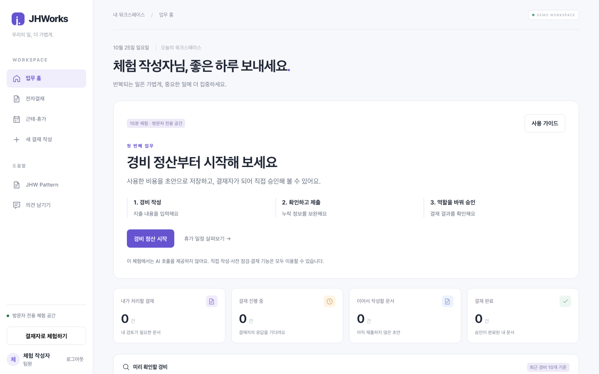
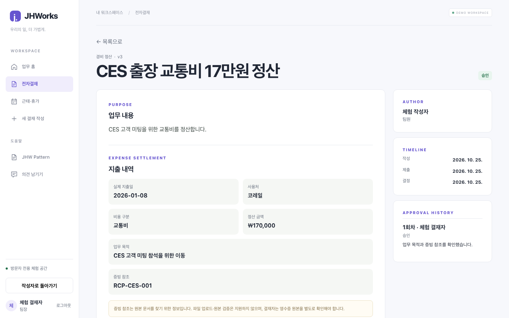
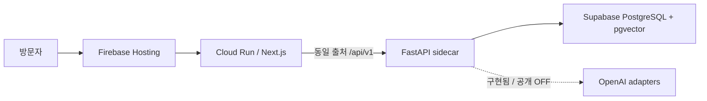
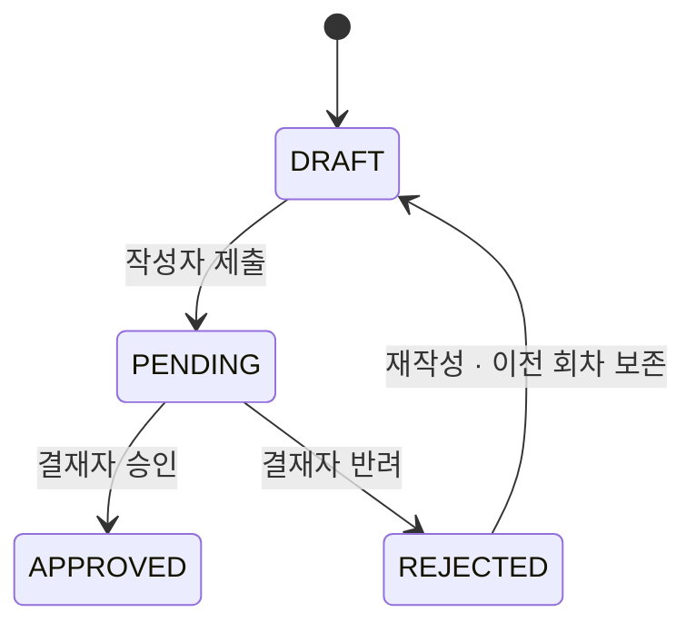

# JHWorks AI Groupware

**업무 요청부터 경비 정산과 승인까지 연결하는 AI 그룹웨어**

“이번 CES 출장에서 쓴 17만원, 경비 정산 올려줘.”

전자결재에서는 요청을 문서로 옮기고, 빠진 정보를 보완하고, 규정에 맞는지 확인하는 일이 반복됩니다. JHWorks는 이 과정을 자연어 초안·정책 검색·누락 및 중복 후보 점검으로 돕습니다. 작성자가 내용을 확인해 제출하면, 결재자는 문서와 처리 이력을 보고 승인하거나 반려합니다.

[라이브 데모](https://groupware.pikan.dev) · [Swagger](https://groupware.pikan.dev/api/v1/docs) · [JHW Pattern](https://groupware.pikan.dev/pattern) · [아키텍처](docs/architecture/README.md) · [포트폴리오](https://pikan.dev/ko/projects/jhworks-ai-groupware)

> **공개 데모:** 가입 없이 경비 작성 → 제출 → 역할 전환 → 승인을 체험할 수 있습니다. 비용 관리 때문에 공개 환경의 AI 호출은 비활성화했습니다. 자연어 초안·정책 RAG·AI 검토는 개발·검증 환경에서 제공하며, 아래에 구현 범위를 정리했습니다.

## 대표 업무: 출장 경비 정산

1. 로그인 없이 체험을 시작합니다. 방문자마다 합성 조직과 업무 공간을 분리합니다.
2. **경비 정산 시작**에서 지출일·사용처·금액·비용 구분·업무 목적을 입력합니다.
3. 저장한 초안에서 누락 정보와 중복 후보를 확인합니다. 증빙 참조는 문서번호이며 원본 파일은 업로드하지 않습니다.
4. 문서·금액·버전을 확인하고 제출합니다. 서버가 작성자의 관리자를 결재자로 지정합니다.
5. **결재자로 체험하기**로 전환해 승인·반려합니다. 작성자 역할에서 처리 결과와 결재 이력을 확인할 수 있습니다.



공개 모드의 PC 업무 홈입니다. 1440 × 900px 뷰포트에서 촬영했으며, 스크롤하면 최근 문서와 다음 할 일을 이어서 볼 수 있습니다.

<details>
<summary>경비 승인 화면과 모바일 화면 보기</summary>



[모바일 업무 홈](docs/portfolio/screenshots/public-home-mobile.png) · [모바일 경비 상세](docs/portfolio/screenshots/public-expense-approved-mobile.png)

</details>

이미지는 외부 AI 호출 없이 실제 UI와 API를 연결한 회귀 테스트에서 촬영했습니다. 조직·직원·정책·업무 데이터는 모두 프로젝트를 위해 만든 가상 데이터입니다.

## 기술과 설계

Next.js · TypeScript · Tailwind CSS 4 · FastAPI · SQLAlchemy · Alembic · PostgreSQL/pgvector · OpenAI · Cloud Run을 사용합니다.

| 영역 | 설계와 구현 | 근거 |
| --- | --- | --- |
| 풀스택·데이터 | FastAPI 모듈 구조, 명령별 권한·상태 전이, version 비교, 결재·연차의 원자적 갱신, Alembic | [아키텍처와 데이터 관계](docs/architecture/README.md), [API 가이드](docs/api/README.md) |
| 프론트엔드 | Next.js App Router·TypeScript·Tailwind 4(사이드바부터 적용), 공통 화면 셸·업무 컴포넌트, 색상·간격·타이포·모션 토큰 | [UI 토큰](packages/pattern/tokens.json), [업무 컴포넌트](apps/web/src/components) |
| UI/UX | 업무 홈에서 다음 행동 안내, 양식별 입력, 역할 전환, 문서·금액 확인 창, 반응형 화면·키보드 조작 | [브라우저 검증](e2e), [공개 데모](https://groupware.pikan.dev) |
| 기업 업무 AI | 자연어 구조화·후속 질문, 정책 RAG와 인용 검증, 사용자 범위 Tool, 저장·제출을 분리한 확인 | [AI와 통제 설계](docs/portfolio/architecture-and-controls.md), [휴가 workflow ADR](docs/adr/0001-durable-leave-agent-state-machine.md) |
| 인프라·운영 | Cloud Run·PostgreSQL, 동일 출처 API 프록시, CI·수동 release·smoke, 방문자 격리·쓰기 예산 | [배포 구조](docs/architecture/README.md), [release runbook](docs/operations/release-runbook.md) |

문서의 `version`을 비교해 오래된 화면의 수정을 거부합니다. 이는 서버의 낙관적 동시성 제어이며, 낙관적 UI 업데이트는 아직 적용하지 않았습니다.

## JHW Pattern과 첫 사용자 경험

[Pattern 문서](https://groupware.pikan.dev/pattern)에서는 실제 제품과 같은 토큰·Button·Badge를 조작하고 사용 코드를 확인할 수 있습니다. 색상·간격·타이포 원본은 [로컬 패키지](packages/pattern)에서 관리하며 CSS와 문서 목록을 함께 생성합니다. npm에는 아직 게시하지 않았습니다.

공개 홈은 지금 가능한 경비 작성을 먼저 제안합니다. 첫 방문의 3단계 가이드는 닫기·다시 보기와 키보드를 지원하며, 양식을 여는 것까지만 안내합니다. 저장과 제출은 사용자가 각각 확인합니다.
[스타일 도구의 역할과 Storybook 도입 기준](docs/design/styling.md), [공식 SaaS 디자인 문서 비교와 적용 기준](docs/design/ux-principles.md)에 원칙·근거·검증 범위를 기록했습니다. 실제 사용자 시간 절감과 완료율은 후속 평가로 남깁니다.

## AI가 맡는 일과 서버가 책임지는 일

| 기능 | AI의 역할 | 서버의 책임 |
| --- | --- | --- |
| 결재 초안 | 요청 유형·날짜·금액을 구조화하고 모호한 정보를 질문 | 양식·필수 항목 검증, 저장 전 미리보기, 확인 토큰·멱등 저장 |
| 문서 검토·정책 RAG | 의미상 누락과 관련 정책 설명 | 숫자·날짜·권한 검사, 검색된 정책만 인용 허용, 오래된 검토 결과 차단 |
| 업무 조회 Tool | 현재 사용자 업무를 조회할 Tool 선택 | actor 범위 제한, 인자 검증, 호출 횟수 제한·실행 기록 |
| 휴가 상담·신청 | 희망 기간 해석, 계산된 후보와 근거 설명 | 잔여 연차·일정·휴일 계산, 저장과 제출의 별도 확인, 변경 직전 재검증 |

권한·금액·날짜·상태 전이는 서버가 검증합니다. AI를 통한 저장과 제출에는 각각 사용자 확인이 필요합니다. 휴가 신청은 상담 → 초안 확인 → 제출 확인의 진행 상태를 DB에 보존합니다.
실제 모델 검증은 고정 합성 경비 사례 **2건**으로 제한했습니다. [평가 방식과 한계](docs/engineering/expense-model-smoke.md)에서 확인할 수 있습니다.

## 아키텍처



백엔드는 도메인·서비스·외부 AI 어댑터를 나눈 모듈형 모놀리스입니다. 세션과 권한은 서버에서 검증하고, 상태를 임의 PATCH하는 대신 `submit / approve / reject / revise` 명령으로 전이합니다.



[전체 아키텍처 문서](docs/architecture/README.md)에는 배포 구성, 내부 책임, 경비 시퀀스, 데이터 관계, 배포 흐름의 다섯 그림을 정리했습니다. [Swagger](https://groupware.pikan.dev/api/v1/docs)에서는 API별 요청·응답과 인증 구조를 확인할 수 있습니다. 공개 문서의 요청 실행은 비활성화했습니다.

## 실행과 검증

Node.js 24+, pnpm 10+, Python 3.12+, uv를 사용합니다. API 키 없이 일반 업무 흐름을 실행할 수 있습니다.

```bash
pnpm install
uv sync --project apps/api
pnpm db:migrate
pnpm db:seed
```

각각의 터미널에서 `pnpm dev:api`와 `pnpm dev:web`을 실행합니다. Web은 `http://localhost:3000`, API 문서는 `http://localhost:8000/docs`입니다.

[로컬 계정·Docker·환경 변수·AI 설정](docs/development.md) · [기여 가이드](CONTRIBUTING.md) · [코드 컨벤션](docs/code-conventions.md)

```bash
pnpm validate                 # lint · 타입 · API 테스트 · Web production build
pnpm test:e2e                 # 일반 업무 · 합성 AI · desktop/mobile
pnpm test:e2e:public-demo     # AI OFF · 공개 방문자 작성/제출/승인
```

일반 CI는 외부 AI를 호출하지 않습니다. PostgreSQL 통합 테스트와 컨테이너 smoke를 별도로 실행하며, 실제 모델 평가는 비용이 발생하는 명령으로 분리했습니다. 최신 배포·검증 근거는 [현재 상태](docs/engineering/current-status.md)와 각 PR에서 확인할 수 있습니다.

## 공개 범위와 다음 단계

- 일반·출장·경비·휴가의 작성·제출과 결재자 역할 전환·승인·반려를 제공합니다. 영수증은 문서번호만 참조하며 파일 업로드·OCR은 지원하지 않습니다.
- 체험은 **15분 / 하루 시작 20회 / 보관 30공간**으로 제한합니다. 자동 정리는 꺼져 있어 보관 상한에 닿으면 새 체험이 중단될 수 있습니다.
- Cloud Run 월 5천원 spend cap과 프로젝트 전체 월 1만원 알림을 설정했습니다. 집계 지연·다른 서비스 비용 때문에 총 청구액의 절대 상한은 아닙니다.
- 공개 AI 활성화, 자동 정리 운영, 예약 백업, main 자동 배포는 후속 과제입니다. 실제 기업의 업무 시간 절감은 아직 측정하지 않았습니다.
- 다음 제품 과제는 비용 제한을 갖춘 경비 AI 공개 연결과 실제 사용자 기반의 사용성 평가입니다.

[세부 로드맵](docs/engineering/roadmap.md) · [설계 결정](docs/adr) · [제품 명세](docs/product)
