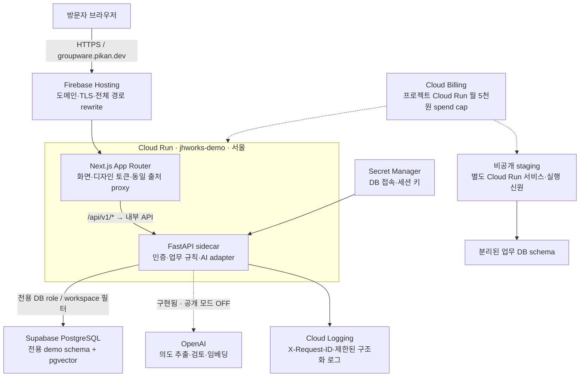
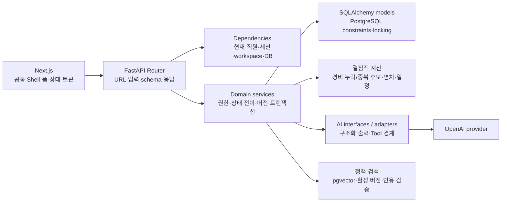
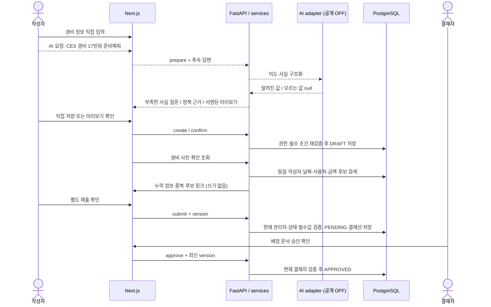
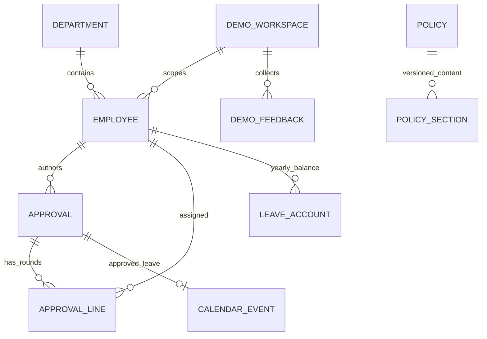
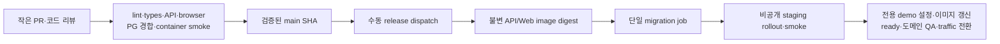

# JHWorks 전체 아키텍처

2026-10-24 기준. **현재 구현·공개 상태**와 **후속 계획**을 구분한다.
대표 문제는 출장 후 지출 내역과 정책을 따로 찾아 결재 양식에 반복 입력하고, 누락·중복을 사람이 재확인해야 하는 일이다.
LLM은 의미와 의도를 구조화하고, 권한·금액·날짜·상태·저장은 일반 코드가 검증한다.

[라이브 체험](https://groupware.pikan.dev) · [Swagger](https://groupware.pikan.dev/api/v1/docs) · [API 안내](../api/README.md) · [설계·검증 근거](../portfolio/architecture-and-controls.md)

## 1. 전체 배포 구조

- Web과 API는 같은 Cloud Run 서비스 안의 두 컨테이너다. 독립적으로 확장되는 마이크로서비스 구조가 아니다.
- 브라우저는 동일 출처 `/api/v1`를 사용한다. `API_PROXY_TARGET`은 빌드 때 고정된 내부 upstream이다.
- demo 전용 실행 신원·DB 자격·세션 키를 사용한다. 방문자는 추가로 workspace 단위 데이터 접근과 만료 검사를 받는다.
- Cloud Run 직접 주소도 공개되어 있다. Hosting 도메인만으로 접근을 제한하는 구조는 아니다.
- 최소 인스턴스 0·최대 1·동시 요청 4. 상한은 비용 위험을 줄이지만 금액의 절대 상한이 아니다.
- Cloud Run 월 5천원 spend cap은 같은 프로젝트의 staging도 포함한다. 무료 크레딧 전 추정 비용 기준이며,
  집계 지연 초과분·Hosting·이미지 보관 등 다른 서비스 비용은 별도다. 프로젝트 전체 월 1만원 알림도 설정했다.
- 공개 AI·자동 정리는 OFF다. 보관 30공간 상한에 닿으면 새 체험은 중단된다. 자동 중단 한도는 다음 달 자동 초기화된다.

## 2. 애플리케이션 내부 책임

| 경계 | 담당 | 맡기지 않는 것 |
| --- | --- | --- |
| 화면 | 입력·미리보기·명시적 확인·로딩/오류·반응형 | 권한·연차 차감의 최종 판정 |
| Router / Pydantic | API 계약과 요청 schema 검증 | LLM 출력의 무조건 저장 |
| Domain service | 현재 직원·관리자·상태·필수값·version 검증 | 클라이언트가 지정한 권한 신뢰 |
| DB | 트랜잭션·유일성·연차 row locking·멱등 수렴 | 모델의 자연어 해석 |
| AI adapter | 의도·사실 구조화·설명·허용된 읽기 Tool 선택 | 임의 SQL·권한 부여·자율 승인 |
| 정책 검색 | 관련 section 탐색·버전/인용 allowlist 확인 | 검색 유사도를 규정 준수의 최종 판정으로 취급 |

백엔드의 `version` 검증은 낙관적 **동시성 제어**다. 화면의 낙관적 업데이트 구현을 주장하지 않는다.
현재 경비 누락·중복 후보는 규칙 기반 조회이며 자율 AI Agent가 아니다.

## 3. 대표 경비 업무 흐름

실선은 공개 데모에서 사용 가능한 경로, 점선은 구현되어 있지만 현재 공개 AI가 꺼진 경로다.

증빙 참조 문자열은 실제 파일 업로드·OCR·영수증 원본 검증이 아니다.
확인 기반 저장과 제출은 별도 단계다. 경비의 일반 submit endpoint와 휴가 Agent의 서명된 submit preview 계약도 구분한다.

## 4. 데이터 구조와 격리

아래는 핵심 관계를 간략화한 그림이며 전체 DDL이 아니다. 정확한 컬럼·제약·index는
[models](../../apps/api/app/models/)와 [Alembic](../../apps/api/alembic/versions/)이 원본이다.

- 결재 문서와 회차별 결재선, 연차 계정, 일정, 정책 section을 관계형 데이터로 관리한다.
- 피드백과 workspace는 해시로 연결되는 논리 관계이며 위 그림의 모든 선이 실제 FK인 것은 아니다.
- 휴가 제출은 예약, 승인은 사용 확정, 반려는 예약 복원이다. DB 트랜잭션과 경합 검증으로 중복 반영을 방지한다.
- 접근 가능한 문서만 반환하며 타 방문자 공간의 ID를 알아도 접근할 수 없다.
- 로컬/일반 테스트는 SQLite·합성 AI를 사용한다. PostgreSQL 전용 경합 테스트는 CI의 별도 PG 환경에서 실행한다.

## 5. 배포와 검증

현재 main 병합만으로 demo가 자동 배포되지는 않는다. 기존 backup/restore 증거는 수동 복원 리허설이며 예약 백업 보장이 아니다.
DB 변경 이후 구 API로 무조건 복귀하지 않는다. EXPENSE를 이해하지 못하는 구 API로의 복귀는 새 문서를 깨뜨릴 수 있다.
필요하면 Hosting 준비 화면과 공개 IAM을 복원해 노출부터 중단하고 호환되는 API를 유지한다.

실제 공개 도메인에서 경비 작성→제출→역할 전환→승인, 세션 쿠키·CSRF·CSP·방문자 격리·로그아웃을 HTTP로 확인했다.
이전 브라우저 점검은 경비 초안 저장까지 확인했으며 제출 confirm 창에서 제어가 멈췄다. 이를 브라우저 전체 E2E 완료로 세지 않는다.
실제 모델 검증은 고정 경비 사례 2건이며 전체 정확도·실사용 생산성 개선을 입증하지 않는다.

## 6. 후속 과제

1. 공개 모드 AI 버튼·설명 일관성, 모바일·키보드 업무 완료.
2. 기존 정리 기능의 승인된 적용·복구 검증으로 보관 상한 회복.
3. OpenAI 별도 호출/토큰 예산·동시성·차단 검증 후 대표 경비 AI 공개 판단.
4. 실제 피드백과 측정에 따른 UX·DB 조회 성능 개선.

ERP·재고·인사와 새 분산 인프라는 현재 대표 시나리오의 선행 조건이 아니다.
