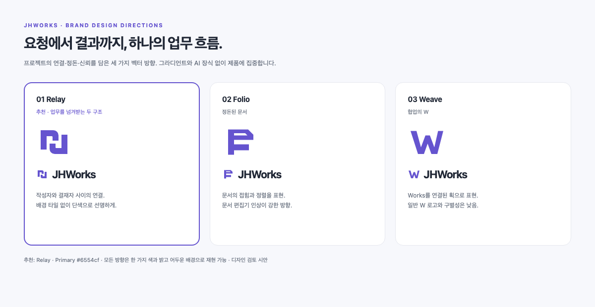

# JHWorks 브랜드 방향 검토

2026-10-25. 제품·브랜드 디자이너 에이전트의 독립 시안이며 실제 사람을 고용한 결과는 아니다. 이 기록은 디자인 제안과 선택 근거를 보관한다. 추천 Relay를 제품 헤더·로그인 역상·OG·favicon에 적용했다.

## 읽고 확인한 맥락

- README: 자연어 경비 요청 → 누락 보완 → 초안 → 제출 → 역할 전환 → 승인. 휴가 도구 하나나 무인 AI 에이전트로 축소하지 않는다.
- UX 원칙: 다음 행동을 명료하게 안내하고, 실제 쓰기와 결정은 사람이 확인한다. 로고도 화려한 AI 장식보다 정돈·신뢰를 표현한다.
- 토큰: primary #6554cf, ink #202735, canvas #f7f8fc. 기존 디자인 언어와 연결하되 브랜드를 둥근 보라색 사각형에 가두지 않는다.
- 실제 PC 업무 홈과 모바일 JHW Pattern 화면을 열어 확인했다. 얇은 사이드바, 한글 중심 화면, 작은 헤더에 버티는 형태가 필요하다.

## 세 가지 방향과 자체 비평

| 방향 | 형태와 의미 | 강점 | 약점·결정 |
| --- | --- | --- | --- |
| **Relay — 추천** | 마주 보는 열린 두 구조. 서로 다른 역할이 한 업무를 넘겨받는다. | 독립 실루엣, 단색 재현, 중앙 여백과 두 기둥의 균형. 문서·근태·AI 보조까지 포괄한다. | 의미를 보지 않고 읽으면 추상 n/j 형태로 보일 수 있다. 억지 J/H 해독을 설명하지 말고 제품과 반복 노출로 정착시킨다. |
| Folio | 접힌 모서리와 정렬된 행 | 문서 업무라는 인식이 빠르다. | F 또는 문서 편집기 브랜드처럼 읽힌다. 전사 업무 흐름으로 확장하는 방향에 비해 좁아 추천하지 않는다. |
| Weave | Works의 W를 연결된 획으로 표현 | 작은 크기와 영문 연결이 명료하다. | 일반 W 로고와 구별성이 낮다. 기존 제품보다 독립적인 브랜드 인상을 얻기 어려워 추천하지 않는다. |

메뉴·서버 아이콘 같은 평행 막대 쌓임을 피했다. Relay는 수평 3줄 아이콘이 아니라 서로 마주 보는 비대칭 모듈의 관계가 중심이다. 체크·스파클·AI 배지·그라디언트는 넣지 않았다. 상표 유사성에 대한 법적 검토나 독점적 고유성 보장은 이 검토의 범위가 아니다.

## 추천 원본

`relay.svg`, viewBox `0 0 48 48`. 다음 fill path 하나가 원본이다.

```svg
<path d="M6 8h17a7 7 0 0 1 7 7v7h-8v-5a1 1 0 0 0-1-1h-7v18H6V8Zm36 32H25a7 7 0 0 1-7-7v-7h8v5a1 1 0 0 0 1 1h7V14h8v26Z"/>
```

배경 타일·외곽 테두리·그림자 없이 사용한다. 기본 fill은 토큰 `var(--jhw-color-primary)`, 단색 문서에서는 `currentColor`, 어두운 배경에서는 흰색이다. 두 모듈을 서로 다른 색으로 나누지 않는다. 내부 여백이 의미와 가독성을 담당하므로 임의로 두껍게 만들거나 붙이지 않는다.

## 적용 규격

- 일반 헤더: SVG box 36px, 워드마크 22px, weight 700, tracking −0.04em, gap 10px. 제품의 기존 폰트를 상속한다. 캡슐이나 장식 테두리를 추가하지 않는다.
- 좁은 화면: box 28–32px, 워드마크 20px, gap 8px. Pattern 접미어는 16–18px·중립 보조색으로 제품명보다 낮게 둔다.
- 작은 단독 심볼: 16px까지 검토했다. 16px에서는 중앙 간격이 약 1.3px이므로 이미지 축소를 여러 차례 하지 말고 SVG로 직접 그린다. 손가락 터치 링크는 심볼 크기와 별개로 충분한 클릭 영역을 둔다.
- favicon: 투명 SVG 원본을 사용하되 라이트·다크 탭 대비를 모두 확인한다. 다크 테마 전용을 만들면 white 단색만 적용한다. 기존 둥근 보라색 바탕 안에 새 심볼을 다시 넣지 않는다.
- OG: 동일 geometry를 크게 사용하고 JHWorks 워드마크와 결합한다. 카드 영역의 8–10% 이상을 장식성 로고에 쓰지 않는다. 기존 제목·설명·서비스 상태 문구는 유지한다.
- 홈 링크: 아이콘은 `aria-hidden=true`, 전체 링크에 `aria-label="JHWorks 홈으로"`. hover는 색이 미세하게 짙어지는 정도, 키보드 포커스는 기존 토큰 outline을 유지한다.
- 여백: 다른 텍스트나 선과의 최소 여백은 심볼 박스의 1/4. 왜곡·기울기·회전·모듈 간격 변경 금지.

## 검토 아티팩트

- `summary.html`, `summary.png`: 사용자 검토용 1200 × 620px 가로형 3후보 요약.
- `preview.html`: 현재와 추천 비교, 3개 방향, 16/24/36/64px, 밝은 배경·단색·어두운 배경, 헤더·사이드바·Pattern 결합. 브라우저에서 폭을 줄이면 1열로 재배치된다.
- 전체 보드의 PC·모바일 렌더는 Git 제외 `artifacts/brand-redesign/`에 있다. HTML을 시안 원본으로 취급한다.
- `relay.svg`, `folio.svg`, `weave.svg`: 완전한 독립 SVG 후보.

최종 권고는 Relay다. 앱 소스·OG·favicon에 같은 path를 공유하고, 중복 수기 geometry를 늘리지 않는다. 이 단계에서는 제품 토큰 전체를 바꾸지 않으며 로고와 홈 탐색의 일관성만 개선한다.

## 실제 적용

제품은 `BrandMark`에서 같은 geometry를 공유해 헤더와 OG를 그린다. favicon은 같은 path의 SVG이며 OS 다크 모드에서는 흰색으로 전환한다. 헤더는 44px 이상 클릭 높이, 작은 화면의32px 심볼/20px 글자, 다크 로그인은 흰색 역상을 쓴다. 공개 배포·AI 설정은 변경하지 않는다.



디자이너 에이전트가 적용 후 Pattern·다크 로그인·OG 렌더도 별도로 검토했다. 로고의 비율·잘림·대비는 수정 필요 사항이 없었고, 함께 발견한 모바일 로그인 제목의 음절 단위 줄바꿈은 keep-all과 작은 화면36px로 개선했다. 마지막32px 심볼·흰색 포커스·모바일36px 제목은 최신 Chromium 렌더에서 재확인했다. 기존 unlayered CSS와 충돌하는 다크 focus 색과 모바일 제목 크기에만 Tailwind important를 적용했다.
