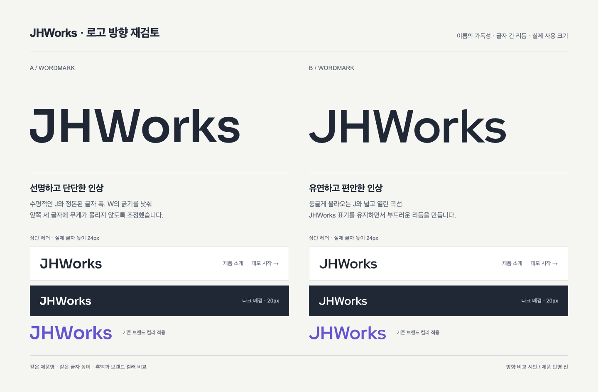
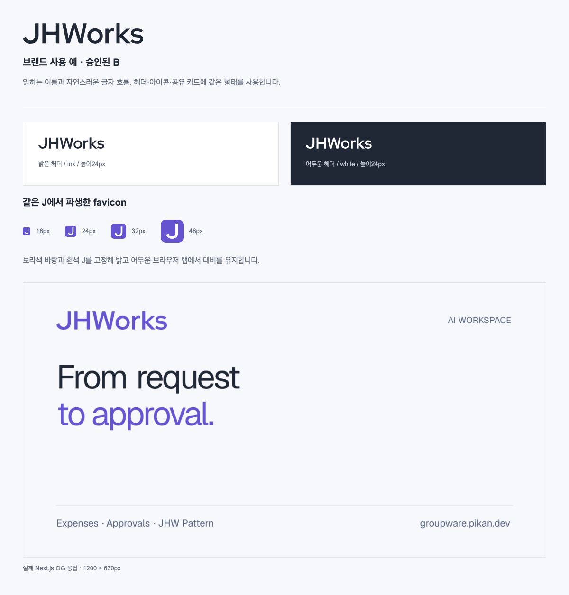

# JHWorks 브랜드 가이드

2026-10-25. 사용자가 승인한 **B 워드마크**를 제품 헤더·로그인·공유 이미지에 적용한다. 완전한 JHWorks 이름과 부드러운 J의 곡선을 유지한다. favicon은 같은 J에서 파생한다.





[브라우저용 사용 예](preview.html) · [실제 OG PNG](og-preview.png)

## 선택과 원본

기존 Relay는 잘린 문자처럼 보이고, Folio는 제품명에 없는 F, Weave는 일반 W로 읽혔다. 세 안의 추천은 철회했다. [이전 검토 기록](archive/round-1/README.md)은 이력으로만 보관한다.

20개 서체를 비교한 뒤 B를 선택했다. Red Hat Display의 윤곽을 기반으로 본문 굵기690·W665와 글자 쌍 간격을 조정했다. 독자적인 서체를 새로 설계한 작업으로 소개하지 않는다. 글자는 SVG path이므로 런타임 폰트 다운로드나 폰트 로딩에 따른 변화가 없다. [SIL OFL 라이선스](../../../apps/web/public/brand/OFL-Red-Hat-Display.txt)를 함께 보관한다.

- [워드마크 원본](../../../apps/web/public/brand/jhworks-wordmark.svg): 승인된 전체 이름, viewBox 578.08 × 100.
- [J 파생 원본](../../../apps/web/public/brand/jhworks-symbol.svg): 48 × 48 박스, 중앙 J의 실제 높이32.
- [공통 컴포넌트](../../../apps/web/src/components/brand-mark.tsx): 헤더와 OG가 동일한 윤곽을 사용한다.

## 사용 규격

| 용도 | 규격 |
| --- | --- |
| 일반 헤더 | 워드마크 글자 높이24px, 너비 약139px, ink `#202735` |
| 480px 이하 헤더 | 글자 높이20px, 너비 약116px |
| 다크 로그인 | 흰색 `#ffffff`, 비율과 간격 유지 |
| 홈 링크 | `aria-label="JHWorks 홈으로"`, 최소44px 클릭 높이, 키보드 포커스 표시 |
| favicon | 보라색 `#6554cf` 바탕과 흰색 J. SVG와 ICO16/32/48px |
| Apple touch icon | 같은 구성, 180 × 180 PNG |
| OG | 1200 × 630 PNG, 같은 보라색 워드마크와 ink·canvas 색상 |

글자 높이의 절반 이상을 주변 요소와 띄운다. 워드마크 자체의 글자 간격·종횡비·대소문자를 바꾸지 않는다. 전체 이름을 정사각 favicon으로 축소하지 않는다. 단색은 ink·white·primary를 사용하고, 그림자나 그라디언트를 추가하지 않는다.

## 생성과 검증

두 SVG 원본에서 React용 path와 SVG favicon을 생성한다. 생성 파일을 직접 편집하지 않는다.

```sh
python3 tools/sync_brand_assets.py
python3 tools/sync_brand_assets.py --check
```

CI는 원본과 생성 파일의 일치를 확인한다. ICO와 Apple PNG는 `apps/web/src/app/icon.svg`에서 각각16/32/48px,180px로 직접 렌더한다. 아이콘 원본을 수정하면 두 래스터 파일도 재생성하고 실제 크기로 확인해야 한다. Next.js 파일 규약을 통해 icon·favicon·apple-touch-icon 메타데이터가 제공된다.

`e2e/brand-sharing.spec.ts`는 홈 링크·320px 화면·아이콘 응답과 크기·공유 PNG·크롤러 메타데이터를 검증한다. Pattern·피드백·로그인·OG 및 favicon 소형 렌더는 실제 이미지로 별도 검토한다. 브라우저 증거는 Git 제외 `artifacts/brand/`에 저장한다.
