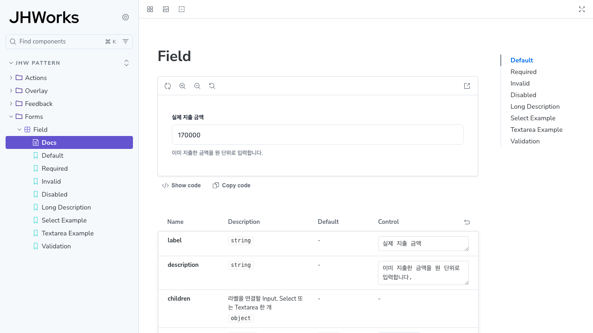

# JHW Pattern의 상태 검증과 정적 배포 — M4-02

Pattern은 원칙·토큰·업무 사용법을 설명하고, Storybook은 같은 컴포넌트의 props·상태·동작을 독립적으로 재현한다. 두 UI의 예제를 구현 복사본으로 유지하지 않는다.

- 원본: `packages/pattern`의 토큰·컴포넌트
- 실제 소비: `apps/web`의 경비 폼·상태·확인 흐름과 `/pattern`
- 독립 소비: `apps/pattern-storybook`의 React/Vite·23개 합성 story
- 검증: 정적 하위 경로의 PC/모바일50개, axe 자동 검사·play 결과·실제 키보드·무API호출



[모바일 확인 창](storybook/confirmation-mobile.png)

## 실행과 배포 파일

```sh
pnpm type-check:storybook
pnpm build:storybook
pnpm test:storybook
node tools/serve-storybook.mjs
```

로컬 정적 확인 주소는 `http://127.0.0.1:6006/storybook/`다. 문서 직접 URL·새로고침·상대 asset 경로와 브랜드 SVG를 확인했다. `storybook-static/`의 HTML/JS/CSS/font/이미지만 배포하며 업무 API나 세션을 올리지 않는다. Git에는 생성물을 쌓지 않고 CI artifact로 보관한다.

현재 빌드는 약10MiB이며 docs/framework chunk의500KiB 경고는 남아 있다. 이 크기는 제품 Next 번들에 추가되지 않는다. Storybook10.6.3·Vite8.3.5·React19.2.8을 고정했고 새로운 프레임워크가 추가된 독립 소비 환경의 타입·빌드·정적 동작을 검증했다.

## 공개 계획 — 아직 배포하지 않음

현재 저장소는 public이고 GitHub Pages는 설정되지 않았다. 업무 사이트의 쿠키·CSP와 분리하기 위해 GitHub의 프로젝트 Pages를 대상으로 준비했다.

예정 주소: `https://tykimdream.github.io/JHWorks-AI-Groupware/`.

[공식 Pages 문서](https://docs.github.com/en/pages/getting-started-with-github-pages/what-is-github-pages)에 따르면 public 저장소에서 사용할 수 있고 프로젝트 기본 주소는 owner.github.io/repository다. GCP 리소스·DNS·키 업로드·AI 사용은 추가하지 않는다. 실제 Pages 공개 설정과 repository variable 활성화는 별도 적용 범위이며, 이 파일이나 workflow 병합만으로 공개되지는 않는다.

`.github/workflows/pattern-pages.yml`은 수동 dispatch만 허용한다.

1. main이며 `PATTERN_PAGES_ENABLED=true`일 때만 시작한다.
2. 같은 main SHA의 성공한 전체 CI를 확인한다.
3. frozen 의존성→패키지/타입→정적 빌드→PC/모바일 검사 후 Pages artifact를 만든다.
4. `github-pages` environment에서 Pages로 배포한다. 이 deploy job만 pages:write/id-token:write를 요청한다.
5. 실제 URL에서 대표 story·docs 직접 링크·브랜드 asset·키보드 확인 후에만 released로 기록한다.

배포가 실패하면 먼저 실행 로그/공개 버전을 확인하고 무작정 재전송하지 않는다. 공개 중단은 Pages 게시 해제, 소스 복귀는 검증한 이전 코드를 되돌리는 PR을 main으로 병합하고 같은 dispatch를 재실행한다. 업무 Cloud Run/Firebase 설정은 변경하지 않는다.

[공식 workflow 지침](https://docs.github.com/en/pages/getting-started-with-github-pages/using-custom-workflows-with-github-pages)과 actions의 실제 최신 tag를 대조해 configure-pages6 / upload-pages-artifact5 / deploy-pages5를 사용한다.

## 검증 한계

초기 정적 테스트는48/50이었다. 두 실패는 Storybook 합성 Esc가 native dialog 기본 동작을 실행하지 않는 차이였고, play 취소 버튼과 실제 Playwright Escape 검사를 분리한 뒤50/50을 확인했다. manager 캡처는 새로고침 뒤 iframe 문서 로드까지 기다리도록 수정해 다시 확인했다.

axe 자동 검사와 개발자 키보드 회귀는 사람의 접근성 평가·전체 WCAG 준수·실사용자의 과제 성공률을 대신하지 않는다. 공개 URL의 결과는 실제 배포 후 별도로 남긴다. npm은 아직 private·UNLICENSED이며 게시하지 않았다.
