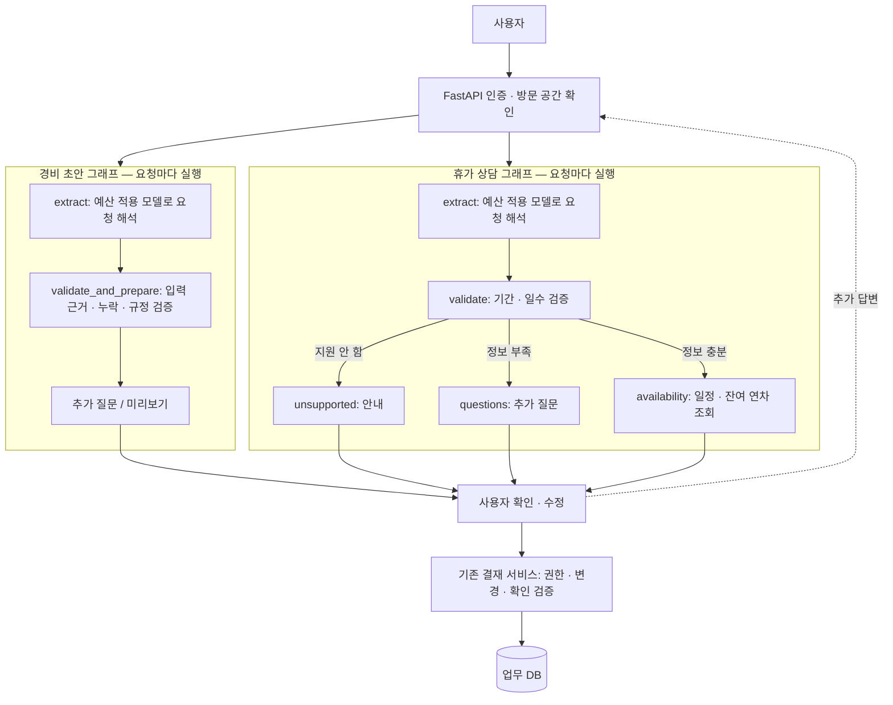

# JHWorks LangGraph 아키텍처 — 2026-10-28

목표는 공개 데모의 경비 초안과 휴가 상담에서 실제 요청을 LangGraph로 조율하고,
기존 권한·예산·규정 검증과 결재 저장 계약을 유지하는 것이다.

- 모델 노드는 API가 주입한 기존 provider를 호출한다. 공개 데모는 workspace 권한과
  공유 예산을 검사하는 provider만 쓴다. 그래프가 모델을 직접 생성하거나 우회하지 않는다.
- 경비의 두 번째 노드는 기존 입력 근거·누락·규정 검사와 확인 토큰 생성을 사용한다.
  저장·결재 제출은 그래프가 실행하지 않는다. 휴가는 기간·일수 검증 후 실제 그래프
  조건 분기로 안내·질문·일정 조회 중 하나를 선택한다.
- 현 단계의 그래프는 **각 HTTP 요청에서 시작해 결과를 반환**한다. `interrupt`와
  checkpoint를 운영에 사용하지 않는다. 경비 추가 답변은 기존 클라이언트가 원문과 함께
  전달하고, 휴가 대기·재개는 기존 업무 DB의 휴가 run 상태 머신이 담당한다.
- LangSmith tracing은 그래프 실행 시 명시적으로 끈다. 그래프에 새 영속 저장소나 원문
  로그, 자동 재시도, 신규 모델 호출을 추가하지 않는다.
- 영수증 확인, 휴가 신청 확정, 다른 사람이 참여하는 장기 대기, 정책 검색 품질 개선은
  이번 그래프가 제공하지 않는다. 운영 checkpoint를 도입하려면 소유권, 만료·삭제,
  동시 재개, 비용·오류 복구를 별도 검증해야 한다.

## 검증

기존 API 테스트는 동일한 서비스 진입점에서 질문·후보·권한·예산·오류·저장 계약을
검사한다. 별도 [학습 실험](../learning/langgraph-expense-comparison-2026-10-28.md)은
임시 SQLite와 가짜 모델로 `interrupt`/재개를 다루며, 운영 구현과 구분한다.
