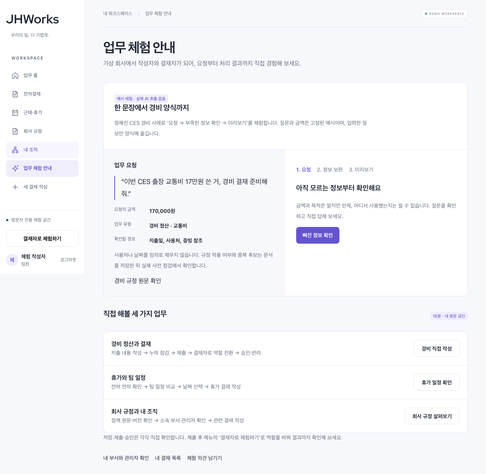

# 프로토타입 우선 체크포인트 — 2026-10-26

사용자 요청에 따라 개발 우선순위를 ‘목록 성능 고도화’에서 **제품의 주요 업무를 처음부터 끝까지 체험할 수 있는 최소 프로토타입**으로 바꾼다. 기존 설계·운영 검증은 보존하며, 이 문서가 당장의 작업 순서를 정한다.

## 공개 반영 상태

[PR #97](https://github.com/tykimdream/JHWorks-AI-Groupware/pull/97)과 필수 CI를 통과한 웹 `10f1412`를 공개 반영했다. 기존 API `b9831c7`을 유지한 최종 revision 100%를 확인했다. [공개 배포 기록](prototype-public-release-2026-10-26.md)에 실제 규정·조직·휴가 후보 조회와 PC/모바일 경비 저장→제출→승인→작성자 결과 확인을 보관한다. 공개 AI는 OFF다.

## 완료 범위

| 업무 | 체험할 동작 | 데이터·실행 경계 |
| --- | --- | --- |
| 업무 홈·체험 안내 | 업무를 선택하고 다음 행동을 찾기 | `/explore`에서 세 가지 대표 업무 안내 |
| 경비 작성 보조 예시 | 고정 요청 → 빠진 날짜·사용처 질문 → 입력 수정·미리보기 → 작성 폼으로 이동 | 고정 합성 시나리오. 실제 AI 추론·규정 판정이 아니며 모델 호출 없음 |
| 실제 결재 | 작성·초안 저장·사전 점검·제출·역할 전환·승인/반려·결과 확인 | 기존 API·권한·확인·트랜잭션 재사용 |
| 근태·휴가 | 잔여 연차·팀 일정·휴가 후보 확인, 휴가 결재 작성 | 기존 구현과 회귀 재사용 |
| 회사 규정 | 활성 원문·버전·시행일·섹션 확인, 분류·단어 검색, 관련 작성 화면 이동 | 기존 인증된 `GET /policies`. 임베딩 검색·AI 호출 없음 |
| 내 조직 | 현재 직원·부서·직속 관리자, 조회 가능한 활성 부서 확인 | 기존 `/employees/me`, `/departments`. 직원 전체 명단·인사 관리가 아님 |
| 도움·피드백·패턴 | 각 화면에서 홈·대표 업무로 돌아가기 | 기존 로고·가이드·Pattern·피드백 연결 유지 |

‘프로젝트 전반’은 위 최소 업무 제품을 뜻한다. ERP·급여·채용·메신저처럼 원래 제외한 새 도메인까지 빈 화면으로 늘리지 않는다. 새로운 수요가 확인되면 별도 범위로 정한다.

## 이번 구현의 UX 선택

JHW의 기존 흰색 `#ffffff`, canvas `#f7f8fc`, 본문 `#202735`, 보조 `#626b7a`, 경계 `#e5e7ee`, 강조 `#6554cf`를 사용한다. 본문 글꼴과 제목 체계를 유지하고 새 화면은 Tailwind의 JHW 토큰 utilities로 구성한다.

체험 안내는 동일한 통계 카드 여러 개 대신 실제 순서가 있는 업무 행과 좌우 요청·결과 작업면으로 구성한다. PC에서는 요청과 보완 결과를 함께 읽고, 모바일에서는 요청→보완 순서로 쌓인다. 규정은 버전 헤더와 접을 수 있는 원문으로 읽는다. 내 조직은 실제 계정·관리자 관계와 허용된 부서를 표시한다.

예시 질문을 표시할 때 지연 애니메이션이나 타이핑 연출로 실제 추론처럼 보이게 하지 않는다. 화면에 ‘예시 체험 · 실제 AI 호출 없음’을 표시한다. 사용자가 입력한 내용과 고정 예시 사실을 구분하고, 규정/중복 판정은 기존 실제 사전 점검에서 수행한다.

## 입력과 안전 경계

- 고정 사례의 금액·목적·분류만 제공한다. 지출일·사용처·증빙 참조는 사용자가 입력한다.
- 미리보기 후 명시적으로 버튼을 누른 경우에만 작성 폼으로 옮긴다. 업무 문서는 ‘초안 저장’을 누르기 전 생성되지 않는다.
- 입력은 기존 actor별 탭 sessionStorage에 최대15분 보관하고 한 번 읽은 뒤 제거한다. URL·외부 분석·장기 저장소에 업무 내용을 넣지 않는다.
- 구조화된 handoff 값은 기본 형식·길이·금액·날짜·유형을 검사한다. 이 값은 서버 권한·도메인 검증의 증명이 아니다.
- 저장소 장애는 화면의 미리보기를 유지하고 오류를 안내한다. 잘못되거나 만료된 값은 작성 폼에 복원하지 않는다.
- 정책·부서 조회는 기존 session epoch별 캐시와 요청 취소를 재사용한다. 역할/로그아웃/만료 시 이전 계정의 캐시가 유지되지 않는다.
- 공개 AI·키·과금·DB·IAM·자동 정리 설정은 변경하지 않는다.

## 검증

`e2e/prototype.spec.ts`는 일반 demo 로그인과 공개 방문 공간의 AI OFF 환경 양쪽에서 실행한다.

- 미리보기 수정→정확한 폼 입력 전달→명시적 저장 1회. 그전 업무 생성 0회·모델 endpoint 요청 0회.
- 실제 정책 API의 버전·섹션 조회, 분류/한영 키워드 검색, 빈 결과 초기화, 조회 실패 후 재시도.
- 실제 계정·관리자·허용 부서 대조, PC/모바일 가로 넘침, axe WCAG A/AA 검사.
- 저장소 장애의 입력 보존과 손상된 구조화 preset 거절.
- 기존 literal handoff·만료·다른 계정·일회성 소비·장애 회귀 유지.

검사에서 공통 내비게이션의 낮은 텍스트 대비를 발견해 기존 JHW 텍스트·강조 토큰으로 수정했다. 검사 대상을 제외하거나 대비 규칙을 끄지 않는다.

긴 본문을 가진 경비를 결재자 목록에서 열 때 모바일 grid의 최소 너비로 행이 넘치는 문제도 발견해 `minmax(0, 1fr)`와 자식 최소 너비를 보완했다. 실제 행 클릭·제출·역할 전환·승인·작성자 결과 조회를 공개 AI OFF 환경에서 검증한다.

로컬 검증 결과: 일반 모드 prototype8개·기존 handoff10개, 공개 모드 기존 흐름 포함18개, 최종 보완 후 공개 prototype8개, production prototype8개를 실행했다. production 검증 뒤 발견한 모바일 목록 너비 수정은 최종 공개 prototype에서 재확인했고 production은 CI에서 다시 확인한다. lint·타입·standalone build도 통과했다. PR CI는 최종 head 기준으로 별도 기록한다.

[PC 캡처](../portfolio/prototype/explore-desktop.png) · [모바일 캡처](../portfolio/prototype/explore-mobile.png)는 공개 AI OFF 합성 환경의 실제 화면이다.

 합성 SQLite·fake provider 기반 회귀를 실제 모델 품질·신규 사용자 효과로 발표하지 않는다.

## 우선순위와 다음 단계

1. 위 화면·대표 흐름·PC/모바일·오류 회복을 검증하고 PR 리뷰·필수 CI 후 병합한다.
2. 실제 공개 배포는 고정 소스·웹/API 호환성·기존 비용 조건을 대조하고 별도 반영 여부를 기록한다. 소스 병합을 공개 반영으로 표시하지 않는다.
3. 신규 사용자의 체험 피드백으로 막힌 동작을 먼저 수정한다. 공개 유료 AI 연결은 기존 비용·키·평가 gate를 따른다.
4. 프로토타입을 막지 않는 대규모 목록 최적화·관측 확장·LangGraph 제품 도입은 후속 트랙으로 둔다. 실제 장애·권한·데이터 손상·예산 우회 결함은 즉시 우선 처리한다.
