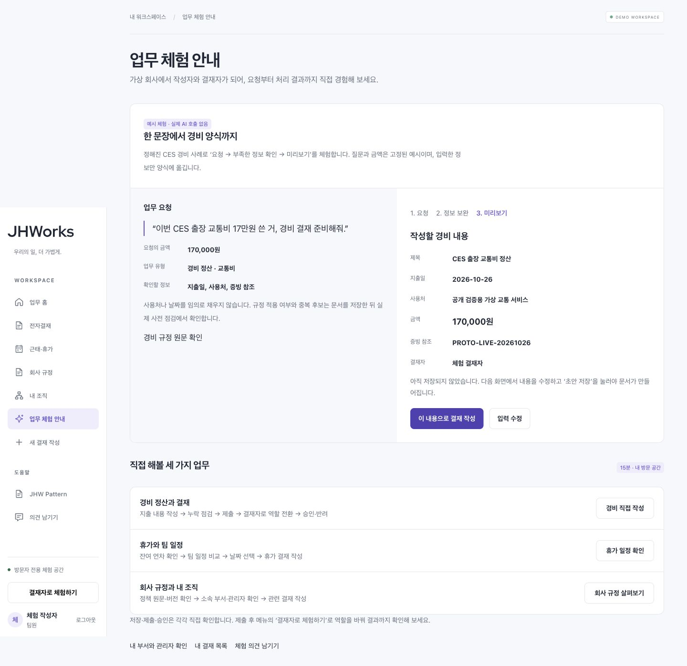
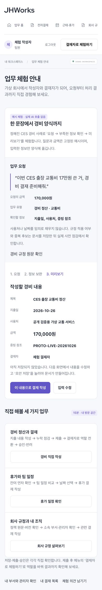
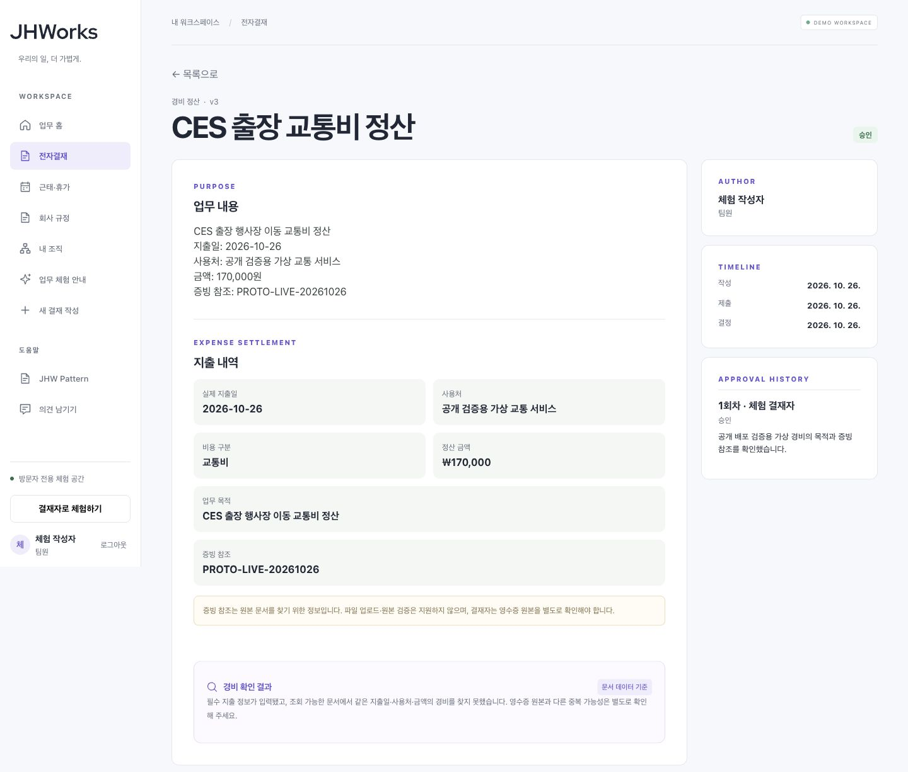
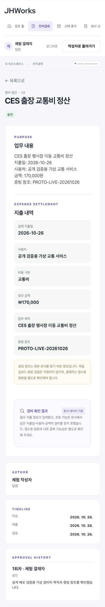

# 프로토타입 공개 반영 — 2026-10-26

[공개 데모](https://groupware.pikan.dev/)에 업무 체험 안내·경비 예시·회사 규정·내 조직을 반영했다. 체험 시작 후 사이드바의 **업무 체험 안내**에서 입력 보완 → 미리보기 → 실제 결재 작성으로 이어진다. 예시에는 ‘실제 AI 호출 없음’을 표시한다.

## 고정 소스와 배포

| 항목 | 검증한 값 |
| --- | --- |
| 웹 소스 | `10f1412ab43a915487655540ba576e21159175c8` — [PR #97](https://github.com/tykimdream/JHWorks-AI-Groupware/pull/97) 병합 |
| 소스 CI | [main 40251893604](https://github.com/tykimdream/JHWorks-AI-Groupware/actions/runs/40251893604) 성공. PR CI의 필수 6개 job도 성공 |
| 웹 manifest digest | `sha256:df7a04b64903f53cf21c309bbc00d447cdd28b0c3e0826cfbd1a488f6e0694dc` |
| 최종 revision | `jhworks-demo-web-10f1412ab43a` — traffic **100%**, 임시 `prototype` tag 제거 |
| 유지한 API | 소스 `b9831c7`, digest `sha256:5828c072c39d1803a5578de3234ce2ee914cb2fb4a5003f379c4f4f24210b8ca` |
| 비용·실행 제한 | service/revision max instances **1**, concurrency **4**, 공개 AI OFF |
| rollback 대상 | `jhworks-demo-web-cb26b8806dda` |

Cloud Shell에서 깨끗한 checkout의 고정 소스로 linux/amd64 웹 이미지를 빌드하고 기존 Artifact Registry로 올렸다. API 프록시는 기존 `http://127.0.0.1:8000`, 브라우저 API 경로는 `/api/v1`이다. 트래픽 0% 후보에서 먼저 확인한 뒤 최종 100%를 재조회했다. [control-plane 증거](evidence/prototype-control-plane-2026-10-26.json)는 실제 CLI의 assertion 출력에서 비밀을 제외한 필드만 옮겼다.

API container 전체, 웹의 image 외 runtime 필드, container 외 runtime spec이 이전 서비스와 같은지 비교했다. API·DB·IAM·키·자동 정리 설정은 변경하지 않았다. 기존 예산 설정은 변경하지 않았으며 이번 기록이 새 청구액 감사나 월 총액 보장을 뜻하지 않는다. 이전 브랜드 배포 기록에서 남았던 control-plane 최종 조회도 이번 배포 전 기존 revision 100%로 확인했다.

## 실제 공개 도메인 확인

한 개의 새 합성 방문 공간에서 PC 1440×900과 모바일 390×844로 확인했다.

- 회사 규정: 실제 API의 규정 3개·섹션 10개·`demo-1.0` 표시. 경비 + ‘영수증’ 검색으로 1개 섹션과 100,000원 증빙 기준 확인.
- 내 조직: 실제 체험 작성자·직속 결재자·조회 가능한 부서 표시.
- 경비: 날짜 2026-10-26·가상 사용처·170,000원·증빙 참조를 미리보기와 저장 전 작성 폼에서 대조. 명시적 저장 **초안 v1 → 제출 확인 후 결재 대기 v2 → 역할 전환 → 승인 확인 후 승인 v3 → 작성자 결과 조회** 완료.
- 모바일: 예시 미리보기와 긴 결재 목록의 `scrollWidth=390`, viewport width=390 확인. 모바일에서 실제 문서 열기·승인 완료.
- 근태: 가용 연차 15일, 요청 2일의 후보 6개 표시. 공통 휴무 제외와 타운홀 주의 상태 확인. 휴가 문서는 생성하지 않음.

[관찰 기록·한계](evidence/prototype-public-ui-2026-10-26.json)를 별도로 보관한다. UI 검증은 합성 경비 문서 1개를 실제 저장·제출·승인했다. 아래 HTTP 검사에서 쓰기 0회라는 결과와 구분한다. 실제 직원 데이터·실제 모델 품질·신규 사용자 효과를 검증한 결과는 아니다.

| PC | 모바일 |
| --- | --- |
|  |  |
|  |  |

[실제 회사 규정 검색 화면](../portfolio/prototype/public-policies-desktop.jpg)도 보관했다. 캡처는 이번 합성 공간의 실제 공개 화면이며 만료 뒤 같은 문서를 계속 열 수 있다는 보장은 아니다.

## HTTP·호환성 확인

- 후보의 새 route 3개 `/explore`, `/policies`, `/organization`: HTTP 200·CSP nonce·404 fallback 아님. [후보 route 기록](evidence/prototype-candidate-routes-2026-10-26.json)은 비인증 HTTP 검사이며 인증 후 UI 검사는 위에 분리했다.
- 후보와 최종 도메인: 아이콘 원본 해시·favicon 링크·OG 1200×630·live/ready 200. [후보](evidence/prototype-candidate-brand-2026-10-26.json) · [최종 공개 도메인](evidence/prototype-public-brand-2026-10-26.json).
- 병합 전 고정된 기존 공개 API 소스와 새 standalone 웹 조합에서 공개 prototype E2E 8개 통과. 일반·공개·production 및 입력 이어받기 회귀는 [체크포인트](prototype-checkpoint-2026-10-26.md)와 PR #97에 기록했다.

후보 tag는 제거했으므로 과거 후보 URL은 현재 지원 진입점이 아니다. 공개 검증 도구는 알려진 최종/후보 hostname만 허용한다.

## 다음 체크포인트

1. 처음 온 사용자가 예시 → 실제 저장 → 역할 전환을 설명 없이 완료하는지 관찰하고 막힌 UX를 먼저 보완한다.
2. 합성 조직 식별자가 그대로 보이는 내 조직 표현, AI OFF 상태의 안내 문구 등을 피드백과 함께 다듬는다.
3. 공개 유료 AI·LangGraph 도입은 비용·평가 조건을 갖춘 별도 작업으로 진행한다. 목록 성능 고도화는 프로토타입 장애보다 앞세우지 않는다.

필요 시 이전 revision으로 되돌리는 명령은 다음과 같다. 이번 기록에서는 실행하지 않았다.

```sh
gcloud --quiet --project=jhworks-staging-tykimdream run services update-traffic jhworks-demo \
  --region=asia-northeast3 --to-revisions=jhworks-demo-web-cb26b8806dda=100
```
