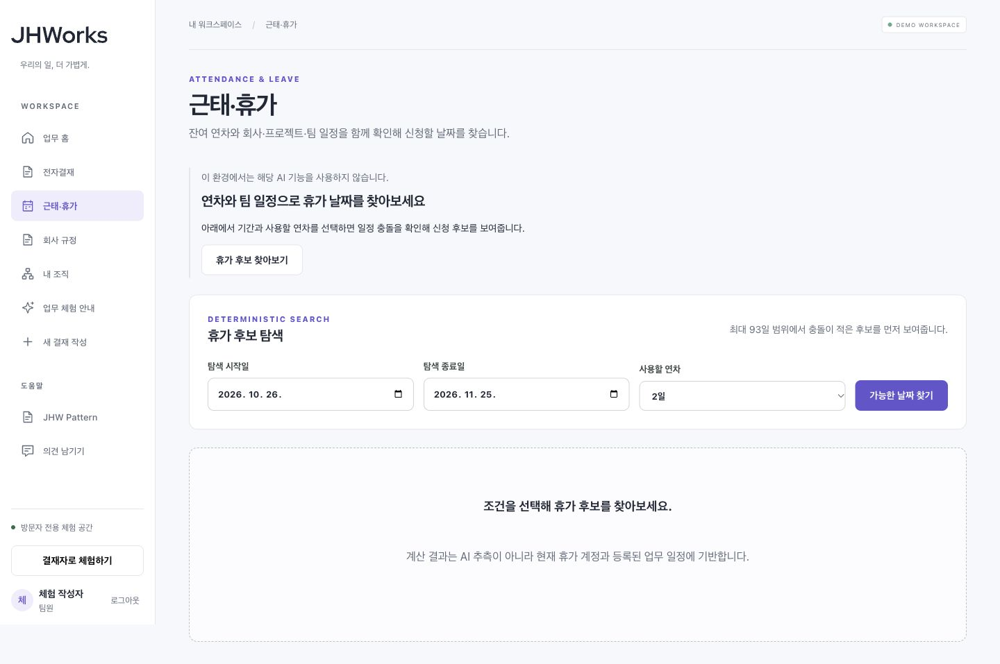

# 첫 사용 안내 공개 반영 — 2026-10-26

[공개 데모](https://groupware.pikan.dev/)에 [업무별 안내·조직 표시 보완](prototype-ux-guidance-2026-10-26.md)을 반영했다. 이제 근태의 AI 비활성 안내는 같은 화면의 실제 휴가 후보 탐색으로 연결되고, 경비 초안 화면은 예시 체험과 직접 작성 중 선택할 수 있다.

## 소스와 변경 경계

| 항목 | 확인한 값 |
| --- | --- |
| 제품 소스 | `72316edb8a76d54da6ae628731ae3f9b38fb4ac4`, [PR #99](https://github.com/tykimdream/JHWorks-AI-Groupware/pull/99) 병합 |
| 제품 CI | [PR 최종 head CI 40256995259](https://github.com/tykimdream/JHWorks-AI-Groupware/actions/runs/40256995259) 6개 성공, [main CI 40257843036](https://github.com/tykimdream/JHWorks-AI-Groupware/actions/runs/40257843036) 성공. main의 dependency-review는 실행 대상이 아니며 나머지 5개 성공 |
| 웹 manifest digest | `sha256:9f3c19308e4412c327abaddcc3bff2ab3a7a01b90ec15d34364e0c3cf1703d2f` |
| 최종 revision / 트래픽 | `jhworks-demo-web-72316edb8a76` / **100%**, 임시 `prototype` tag 제거 |
| API 유지 | 소스 `b9831c7`, digest `sha256:5828c072c39d1803a5578de3234ce2ee914cb2fb4a5003f379c4f4f24210b8ca` |
| 실행 제한 유지 | service/revision max instances 1, concurrency 4, 공개 AI OFF |
| rollback 대상 | `jhworks-demo-web-10f1412ab43a` |

Cloud Shell의 깨끗한 checkout에서 linux/amd64 웹 이미지를 빌드하고 기존 registry로 올렸다. source label·이미지 digest·기존 설정이 일치하는지 확인한 뒤 0% 후보를 만들었다. 후보 생성 중 컨테이너 시작 검사는 통과했으나 Cloud Run의 최종 준비 상태가 확정되기까지 수분 대기했다. 기존 트래픽 100%를 유지했으며 준비 완료 전 전환하지 않았다. 지연을 이유로 인스턴스·startup probe·보안 설정을 바꾸지 않았다.

[최종 control-plane 증거](evidence/ux-control-plane-2026-10-26.json)는 실제 assertion 출력에서 비밀을 제외한 필드만 보관한다. API container 전체, 웹 image 외 runtime, container 외 runtime spec을 이전 설정과 비교했다. API·DB·IAM·키·자동 정리는 변경하지 않았다. 예산 설정은 변경하지 않았으며 이번 기록이 청구액 감사나 월 총액 보장을 뜻하지 않는다.

## 공개 도메인 확인

새 합성 공간 1개에서 실제 API를 사용하는 화면을 확인했다. 이번 확인에서는 업무 문서를 저장하지 않았다.

- 근태: 업무별 안내와 후보 조건 폼으로의 키보드 포커스 이동. 가용 연차 15일·요청 2일·후보 6개 계산. ‘이 날짜로 휴가 결재 작성’이 실제 미저장 휴가 폼의 2026-10-26~27 날짜로 연결됨.
- 내 조직: ‘내 체험 조직’ 표시와 원본 부서명·이메일 펼침. API 데이터와 별칭을 구분해 확인.
- 경비 AI 초안 직접 주소: AI OFF 상태에서 예시와 직접 작성 링크 표시. 예시 링크가 ‘실제 AI 호출 없음’ 화면으로 이동함.
- PC 1440×900, 모바일 390×844. 모바일 근태와 원본 정보를 펼친 조직 화면의 scrollWidth는 각각 390으로 가로 넘침 없음.

[공개 UI 관찰 기록](evidence/ux-public-ui-2026-10-26.json)은 자동 회귀나 신규 사용자 측정 결과와 구분한다. 실제 모델 품질 평가는 아니며 브라우저 모델 endpoint 트래픽을 별도 계측한 기록도 아니다. 실제 경비 저장→제출→역할 전환→승인→작성자 결과 확인은 [직전 공개 프로토타입 검증](prototype-public-release-2026-10-26.md)에 보관했다.



[공개 모바일 조직 화면](../portfolio/prototype/ux-public-organization-mobile.jpg)도 보관했다. 로컬 캡처와 공개 캡처를 별도 파일로 유지한다.

후보와 최종 도메인의 health live/ready 200·아이콘 원본 해시·OG 1200×630을 확인했다. [후보 HTTP 검사](evidence/ux-candidate-brand-2026-10-26.json) · [공개 HTTP 검사](evidence/ux-public-brand-2026-10-26.json). 이 검사만의 쓰기/모델 호출 0회는 새 합성 공간을 만든 UI 과정 전체를 뜻하지 않는다. 임시 후보 tag는 제거했다.

## 다음 사용자 검증

[기존 경비 과제 절차](../portfolio/expense-task-study.md)에 공개 프로토타입의 `fixed-example` 조건과 미리보기/저장·역할 전환·고정 예시 이해의 관찰 지점을 추가했다. 참가자 모집·실제 측정은 대기 중이며 성과 수치를 채우지 않았다. 직접 작성·고정 예시·미래의 실제 AI 조건을 서로 구분한다.

필요 시 이전 웹으로 되돌리는 명령은 다음과 같다. 이번 기록에서는 실행하지 않았다.

```sh
gcloud --quiet --project=jhworks-staging-tykimdream run services update-traffic jhworks-demo \
  --region=asia-northeast3 --to-revisions=jhworks-demo-web-10f1412ab43a=100
```
