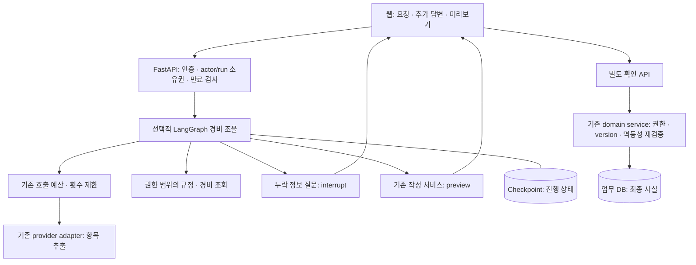

# LangChain·LangGraph 학습과 JHWorks 적용 제안

> 조사일: 2026-10-26 · Python 기준 · 상태: 학습 실습 검증, 제품 도입은 제안 단계

## 1. 먼저 내릴 결정

**배우는 것은 추천한다. 제품 전체를 프레임워크로 교체하는 것은 추천하지 않는다.** JHWorks에서는 ‘경비 요청 → 부족한 정보 질문 → 규정·중복 확인 → 작성 미리보기’ 흐름을 작은 LangGraph 실험으로 만들고, 현재 서비스 구현과 비교하는 것이 좋다. 학습 실습은 이 문서와 함께 제공한다. 실제 모델·업무 API·클라우드에는 연결하지 않는다.

우리가 어필할 것은 라이브러리 이름보다 **기업 업무를 이해하고, AI의 유연함과 업무 규칙의 정확성을 함께 설계하는 능력**이다. 예를 들어 “CES 출장 17만원 사용한 거 결재 올려줘”라는 요청에서 AI는 항목을 추출하고 질문을 만들지만, 권한·중복·금액·최종 저장은 서버가 검증해야 한다. 현재 휴가 흐름에는 이미 이 원칙이 적용돼 있다.

추천 순서는 모델·Tool 개념 → LangChain의 간단한 Tool loop → LangGraph의 명시적 상태·중단·재개 → 실패 평가다. LangSmith와 Deep Agents는 그다음 선택지다. 공식 문서도 LangGraph를 모델·Tool과 구분되는 낮은 수준의 실행 조율 도구로 설명하며, LangChain 없이도 사용할 수 있다고 명시한다. [LangGraph 개요](https://docs.langchain.com/oss/python/langgraph/overview)

## 2. 각각 무엇을 해결하나

| 기술 | 쉬운 설명 | JHWorks에서의 후보 용도 | 지금의 판단 |
| --- | --- | --- | --- |
| LangChain | 모델·Tool·프롬프트·middleware를 묶어 Agent loop를 구성하는 도구 | 읽기 전용 업무 질의의 Tool 선택 실험 | 개념·작은 예제부터 학습 |
| LangGraph | 상태와 다음 실행 단계를 그래프로 정의하고 중단·재개하는 실행 구조 | 경비 정보 보완, 사용자 확인 대기, 실패 재개 | 독립 실험 우선 |
| LangSmith | 실행 추적·평가·디버깅을 위한 플랫폼 | 정제한 합성 사례의 경로·지연 비교 | 외부 전송 조건 검토 후 선택 |
| Deep Agents | 파일·context 관리와 하위 Agent 등 복잡한 과업용 기능을 갖춘 harness | 장기 조사·문서 작업이 실제 요구가 될 때 | 현재 경비 흐름에는 보류 |

현재 LangChain 문서의 입문 API는 `create_agent`다. 내부 구현 방식이나 오래된 강좌의 API를 섞기보다 설치 버전과 공식 문서 예제를 함께 확인한다. LangChain Agent와 LangGraph는 반드시 둘 중 하나만 선택하는 관계가 아니다. [LangChain 개요](https://docs.langchain.com/oss/python/langchain/overview)

LangSmith는 프레임워크와 별도로 사용할 수 있는 관측 도구다. OSS 그래프 실행을 위해 SaaS를 활성화할 필요는 없다. Deep Agents는 LangChain·LangGraph 위에 더 많은 실행 기능을 얹으며, 파일 접근·위임이 필요한 과업에 적합한지 별도로 판단한다. [생태계 구성](https://docs.langchain.com/oss/python/langgraph/overview), [Deep Agents 개요](https://docs.langchain.com/oss/python/deepagents/overview)

### 처음 볼 때 헷갈리는 용어

| 용어 | 의미 | 주의할 점 |
| --- | --- | --- |
| Tool calling | 모델이 함수 이름과 인자를 제안하는 것 | 실제 함수 실행 허가와 권한 검증은 서버의 일 |
| Workflow | 개발자가 실행 순서·분기를 설계한 흐름 | LLM을 넣어도 모든 단계가 자율 Agent가 되는 것은 아님 |
| Agent | 모델이 다음 Tool·행동을 선택하는 구조 | 자유도가 커질수록 호출 수·실패 경로도 늘어남 |
| State / Node / Edge | 진행 정보 / 수행 단계 / 다음 단계 연결 | DB 세션·키·인증 토큰을 State에 넣지 않기 |
| Checkpoint | 이어서 실행할 수 있도록 저장한 그래프 상태 | 업무 DB의 최종 결재 사실을 대신하지 않음 |
| `thread_id` | 같은 그래프 실행 기록을 찾는 식별자 | 사용자 인증 정보가 아님 |
| Interrupt / Resume | 외부 입력을 기다리며 멈춤 / 입력을 받아 이어감 | 중단된 node는 재개 시 처음부터 다시 실행될 수 있음 |
| RAG | 관련 자료를 찾아 모델 입력에 근거를 보태는 방식 | 그래프 도입만으로 검색 품질이 좋아지지 않음 |

Workflow와 Agent를 구분해 필요한 자율성만 선택한다. 고정 분기·병렬 처리·평가 후 수정 등의 패턴은 서로 다른 문제를 해결한다. [Workflows and agents](https://docs.langchain.com/oss/python/langgraph/workflows-agents)

## 3. 시장에서 관심이 있다는 말은 어디까지 사실인가

LangChain의 공개 설문은 1,340명 응답 중 57.3%가 운영 환경에서 Agent를 사용한다고 보고한다. 다만 조사 기간은 **2025-11-18~12-02**이며, 페이지 표시 날짜인 2026-06-12와 다르다. 응답자의 63%가 기술 업종이고 49%가 100명 미만 조직이다. 공급사가 진행한 공개 설문이므로 일반 기업 전체의 대표 표본으로 볼 수 없다. 이 수치를 **LangChain 점유율이나 한국 채용 수요로 해석해서도 안 된다.** [설문 결과·방법론](https://www.langchain.com/state-of-agent-engineering)

따라서 이 보고서의 판단은 ‘학습할 만한 생태계와 실무 주제가 있다’까지다. 국내 공고를 수집·집계하지 않았으므로 ‘국내 취업 필수 기술’이라는 결론은 내리지 않는다. 포트폴리오에서는 단순 도입보다 왜 사용했고, 어디에 사용하지 않았으며, 장애·비용·권한을 어떻게 통제했는지가 설명력이 높다는 것이 우리의 기획 판단이다.

복잡도를 최소한으로 시작하라는 설계 원칙은 2024년 Anthropic의 엔지니어링 글에서도 확인할 수 있다. 이는 현재 API 안내가 아니라 Workflow·Agent를 선택하는 개념 참고 자료로 읽는다. [Building effective agents](https://www.anthropic.com/engineering/building-effective-agents)

## 4. 우리 프로젝트에는 이미 무엇이 있나

| 현재 코드·문서 | 이미 해결하는 문제 | 도입 시 지킬 경계 |
| --- | --- | --- |
| [휴가 상태 머신 ADR](../adr/0001-durable-leave-agent-state-machine.md) | 중단·재개, 확인 snapshot, 재시도, 성공 replay | Accepted 결정을 이번 학습으로 뒤집지 않음 |
| [leave_agent.py](../../apps/api/app/services/leave_agent.py) | actor별 실행 상태, preview와 제출 확인, 저장 후 응답 유실 복구 | 같은 책임의 checkpoint를 중복 도입하지 않음 |
| [approval_draft.py](../../apps/api/app/services/approval_draft.py) | 경비 입력 정규화, 누락 필드, 작성 preview·확인 | Graph는 이 서비스의 호출 순서를 조율하는 후보 |
| [expense_checks.py](../../apps/api/app/services/expense_checks.py) | 규칙 기반 경비 점검·중복 확인 | 판정 책임을 프롬프트로 옮기지 않음 |
| [enterprise_tools.py](../../apps/api/app/services/enterprise_tools.py) | 사용자 범위의 읽기 전용 업무 Tool | Graph에서도 동일한 권한·조회 한도 적용 |
| [work_assistant.py](../../apps/api/app/services/work_assistant.py) | 업무 질문과 provider·Tool 연결 | 교체 전 동일 사례로 품질·호출 수 비교 |
| [실제 경비 모델 평가](../engineering/expense-model-results-2026-10-25.md) | 합성 사례 기반 실제 모델 평가 기록 | 학습용 fake 통과를 모델 품질 개선으로 표현하지 않음 |

현재 API는 OpenAI SDK·FastAPI·SQLAlchemy를 사용하며 LangChain·LangGraph는 제품 의존성에 없다. 휴가 ADR은 고정된 작은 분기에서 업무 DB와 별도 checkpoint의 중복을 피하기 위해 직접 상태 머신을 선택했다. 이는 타당한 선택이다. 동적 Tool loop·병렬 분기·외부 시스템 handoff가 실제 요구가 될 때 재검토한다.

## 5. 가장 좋은 첫 적용 후보: 경비 작성 보조

**기업 문제:** 직원은 양식과 규정을 모르고, 결재자는 누락·중복 지출을 다시 확인하느라 시간을 쓴다.

**데모 장면:** 사용자가 “이번 CES 출장 17만원 사용한 거 결재 올려줘”라고 입력한다. 시스템은 확인되지 않은 상호·사용일을 만들어내지 않고 필요한 항목만 질문한다. 규정 근거와 중복 후보를 보여준 뒤 수정 가능한 미리보기를 제공한다. 최종 저장·상신은 각각 기존 서비스의 명시적 확인 절차를 거친다.



이 그림은 **도입 제안**이며 현재 배포 구조가 아니다. 예산 검사는 실제 provider 호출 전에 적용한다. Checkpoint는 진행 상태만 담고, 최종 결재 사실은 업무 DB에 남긴다. 초기 실험은 Preview까지이며 쓰기 Tool을 그래프에 주지 않는다.

### 단계별 책임

1. 요청 해석: 금액·통화·목적을 구조화한다. 모르는 필드는 비워둔다.
2. 자료 조회: actor 범위의 규정·기존 요청을 제한된 수량으로 읽는다. 검색 실패와 ‘자료 없음’을 구분한다.
3. 보완 질문: 누락된 필드를 보여주고 중단한다. 답변은 스키마로 검증하고 재질문 횟수를 제한한다.
4. 점검: 중복 후보·규정 위반은 기존 결정적 코드로 계산한다. 모델의 문장은 설명으로 사용한다.
5. Preview: 사용자가 결과·근거·수정 항목을 확인한다. 취소 시 업무 DB 변경은 없다.
6. 확인 이후: 기존 확인 API가 현재 권한·version·멱등 키를 다시 검증한다. Graph의 과거 성공 표시만으로 저장하지 않는다.

### 다른 기능의 우선순위

| 후보 | 기업 가치 | 우선순위와 이유 |
| --- | --- | --- |
| 경비 작성·정보 보완 | 입력 누락·왕복 감소 | 1순위: 기존 서비스·평가 사례를 재사용 가능 |
| 경비 이상 징후 설명 | 결재 검토 시간 감소 | 2순위: 현재 규칙 기반 insight에 근거 설명을 추가 |
| 휴가·근태 상담 | 규정 문의·신청 편의 | 기존 흐름 유지, Graph 교체 효과부터 증명 |
| 재고 발주 선제안 | 품절·과잉 재고 감소 | 보류: 현재 재고 도메인·실측 수요 데이터가 없음 |
| 인재 평가·자동 인사 결정 | 업무 자동화 가능성 | 보류: 데이터·공정성·검토 책임부터 설계 필요 |

선제안이 꼭 자율 Agent일 필요는 없다. 규칙·SQL로 후보를 계산하고, AI가 근거를 설명하며, 사용자가 실행을 선택하는 형태부터 시작하는 것이 현재 데모에 적합하다.

## 6. 중단·재개에서 반드시 이해할 설계

Checkpoint는 thread 단위 상태를 저장하고 Store는 thread 밖의 장기 정보를 담는 별도 개념이다. 메모리 저장소는 학습에는 편하지만 프로세스 종료 이후 복구 근거가 되지 않는다. [Persistence](https://docs.langchain.com/oss/python/langgraph/persistence)

`interrupt()`에는 직렬화 가능한 질문을 전달하고, 같은 `thread_id`에 `Command(resume=...)`를 보내 이어간다. Checkpointer가 필요하며, 재개 시 node 앞부분이 다시 실행될 수 있으므로 그 앞에서 메일 발송·결재 저장을 수행하면 중복될 수 있다. [Interrupts](https://docs.langchain.com/oss/python/langgraph/interrupts)

JHWorks 적용 시 다음은 프레임워크가 자동 해결해 주지 않으므로 우리가 구현해야 한다.

- **소유권:** 서버가 run과 actor/workspace를 연결하고, 매 조회·재개마다 검증한다. 클라이언트가 보낸 `thread_id`만 믿지 않는다.
- **만료:** 15분 체험 종료·workspace 삭제와 checkpoint 정리 정책을 연결한다. 중단 상태가 무기한 남지 않게 한다.
- **최종 사실:** Graph checkpoint와 업무 transaction이 별도 저장이면 원자적으로 함께 완료된다고 가정하지 않는다. 저장 후 응답 유실 때는 멱등 키로 업무 결과를 조회해 수렴시킨다.
- **오래된 확인:** preview fingerprint·domain version이 달라지면 다시 preview를 만든다. 이전 확인으로 새 금액을 저장하지 않는다.
- **예산:** node 재실행·provider retry·Tool loop를 모두 실제 호출 한도에 포함한다. 초기 실험은 자동 retry 0, 제한된 질문 횟수로 시작한다.
- **개인정보:** 키·JWT·DB 세션·원문 영수증 전체를 State에 넣지 않는다. 필요한 정제 필드와 참조 ID만 둔다.
- **UI:** ‘정보가 필요함 / 확인 가능 / 처리 실패 / 만료’ 상태와 다음 행동을 보여준다. 모델의 내부 추론을 노출하는 대신 단계·근거·결과를 표시한다.

LangSmith를 나중에 쓸 때도 입력·출력·metadata 전송 범위를 따로 정한다. 공식 도구에는 숨김·마스킹·조건부 tracing 기능이 있지만, 이 기능의 존재만으로 현재 데이터의 전송이 승인되는 것은 아니다. 이번 실습은 tracing을 끈다. [민감정보 추적 방지](https://docs.langchain.com/langsmith/mask-inputs-outputs)

## 7. 학습 순서와 직접 해볼 과제

각 회차는 45~90분 학습 단위로 나눈 제안이다. 소요 시간은 이해도에 따라 달라진다.

| 회차 | 배울 것 | 직접 만들 결과 | 이해 확인 질문 |
| --- | --- | --- | --- |
| 1 | 구조화 출력·Tool schema·서버 실행 | 경비 입력 JSON과 누락 필드 표 | 모델의 함수 호출 제안이 왜 실행 권한은 아닐까? |
| 2 | LangChain `create_agent`, 모델·Tool loop | 합성 규정 조회 Tool 1개를 호출하는 별도 연습 | 고정 함수 호출보다 loop가 필요한가? |
| 3 | State·Node·conditional edge | 아래 무과금 경비 그래프 실행·분기 수정 | 상태와 업무 DB 사실은 무엇이 다른가? |
| 4 | SQLite checkpoint·interrupt·resume | 연결을 닫고 새 graph에서 같은 실행 재개 | 왜 interrupt 앞의 쓰기가 위험할까? |
| 5 | 권한·멱등성·취소·만료 | 기존 서비스와 비교한 실패 시나리오 표 | 남의 thread ID를 알면 재개할 수 있는가? |
| 6 | 관측·평가 | fake 제어 흐름과 실제 모델 평가를 나눈 결과표 | fake 통과가 추출 정확도를 증명하는가? |
| 7 | 기존 코드와 비교 | 같은 합성 입력·preview 계약으로 비교하는 prototype | 유지보수 복잡도가 실제로 줄었는가? |
| 8 | 선택 결정 | 채택 또는 미채택 ADR + 3분 데모 설명 | 라이브러리를 빼도 설명할 업무 가치가 남는가? |

읽을 순서: [LangChain 입문](https://docs.langchain.com/oss/python/langchain/overview) → [Workflow 패턴](https://docs.langchain.com/oss/python/langgraph/workflows-agents) → [Graph로 사고하기](https://docs.langchain.com/oss/python/langgraph/thinking-in-langgraph) → [Graph API](https://docs.langchain.com/oss/python/langgraph/use-graph-api) → [테스트](https://docs.langchain.com/oss/python/langchain/test). 추가 과정은 [공식 학습 안내](https://docs.langchain.com/oss/python/learn)에서 선택한다.

### 바로 실행하는 무과금 실습

[expense_graph.py](examples/expense_graph.py)는 모델 대신 합성 데이터를 사용한다. `uv`가 처음 실행할 때 고정한 오픈소스 패키지를 다운로드하지만 API 키·모델·업무 API·LangSmith를 사용하지 않는다. 제품의 pyproject·lockfile에는 의존성을 추가하지 않는다.

```sh
uv run --no-env-file --script docs/learning/examples/expense_graph.py
```

실습은 정보 부족 시 중단, SQLite 연결을 닫은 후 새 graph에서 재개, 취소, 잘못된 보완 값 거절을 확인한다. 임시 DB는 종료 시 삭제한다. **실제 프로세스 강제 종료 복구·운영 PostgreSQL·사용자 인증·모델 품질·업무 저장은 검증하지 않는다.** 입력은 고정 fixture이며 자연어 파싱 실습도 아니다.

코드에서 `interrupt()` 앞에 카운터를 넣어 재개 시 재실행을 관찰해 보고, 왜 그 자리에 결재 저장을 두면 안 되는지 설명해 보자. 실제 업무 데이터나 쓰기 API를 연결할 필요는 없다.

## 8. 제품 적용 로드맵과 채택 조건

| 단계 | 범위·산출물 | 완료 조건 | 공개 영향 |
| --- | --- | --- | --- |
| L0: 이번 변경 | 보고서·독립 fake 실습 | 중단·재개·취소·검증 실패 확인 | 없음 |
| L1: 계약 비교 | 기존 경비 사례를 공통 입력·결과 계약으로 정리 | 양 구현의 결과·실패 차이를 재현 | 없음 |
| L2: 읽기 전용 prototype | 기존 provider·Tool adapter와 연결, feature flag 기본 OFF | actor·만료·loop 예산·실패 테스트 통과 | 로컬 fake 우선 |
| L3: 영속성 비교 | 서버 소유 run 매핑·Postgres checkpoint·정리 정책 | 재시작·응답 유실·stale·타 사용자 재개 거절 검증 | migration은 별도 검토 |
| L4: 도입 결정 | 비용·지연·코드 복잡도 비교 ADR | 아래 기준 충족 시에만 채택 | 모델 평가·배포 조건 별도 확인 |

L0 완료가 L2~L4 완료를 뜻하지 않는다. 기존 휴가 ADR은 그대로 유효하며, L4에서 경비 범위의 새 결정을 작성한다. 단순히 배웠다는 이유로 기존 상태 머신을 교체하지 않는다.

비교 지표는 다음과 같다. 수치는 **채택 기준 제안**이며 아직 달성 결과가 아니다.

| 측정 | 채택 판단 |
| --- | --- |
| 권한 밖 조회·확인 전 저장·취소 후 저장 | 각각 0건: 필수 조건 |
| 필수 필드 누락·잘못된 값 | 저장까지 진행하지 않고 보완/오류 반환 |
| 같은 확인의 반복·응답 유실 | 업무 결과 1개로 수렴 |
| 고정 사례의 계약 통과율 | 기존 구현보다 악화되지 않음 |
| 실제 모델 추출 품질 | 동일 입력·모델·평가 기준으로 별도 비교 |
| 호출 수·예산 | 기존 호출 guard 우회 없음, 실행별·월 한도 유지 |
| p50/p95 지연 | 환경·표본 수를 기록해 비교, 학습 DB 수치로 운영 성능 주장 금지 |
| 구조 복잡도 | 새 checkpoint 정리·복구 비용을 포함해 유지보수 이점 설명 가능 |

새 상시 worker나 관리형 Agent 서버는 초기 실험에 필요하지 않다. 요청마다 저장된 실행을 재개하는 방식을 먼저 비교한다. 장기간 승인을 기다리기 위해 HTTP 연결을 계속 붙잡는 구조는 피한다. 공개 AI는 현재 OFF를 유지하며, 이번 보고서가 새로운 유료 실행·외부 tracing·원격 migration 승인을 대신하지 않는다.

## 9. 기존 일정과 연결

지금까지 만든 공개 데모·디자인 시스템을 보여줄 수 있는 상태는 유지한다. 다음 제품 작업은 기존 **M5 목록 성능 검증**을 이어가는 것이다. 서비스 baseline만으로 끝내지 않고 HTTP·브라우저 체감·쿼리 plan을 측정한 뒤 목록 summary/pagination 계약을 조정한다. 홈 집계와 AI Tool 조회도 함께 맞춰야 한다.

LangGraph는 이를 미루는 전면 개편이 아니라 독립 학습 트랙으로 둔다. 목록 조회가 무제한이면 그래프만 도입해도 Tool 비용·응답 크기는 해결되지 않기 때문이다. 이후 경비 보완 prototype을 얹고, 사용자의 요청에서 질문·근거·미리보기까지 이어지는 UX와 평가 결과를 함께 포트폴리오에 담는다.

## 10. 버전 기록과 확인 한계

2026-10-26 PyPI JSON 조회 시점의 버전은 LangChain `1.4.7`, LangGraph `1.2.17`, SQLite checkpointer `3.1.2`, Postgres checkpointer `3.2.0`, LangSmith `0.14.12`, Deep Agents `0.7.32`였다. 최신 버전은 바뀔 수 있으며 이 표는 모든 조합의 호환성 검증이 아니다. 실습은 LangGraph·SQLite 두 패키지를 고정해 실행했다. [LangGraph PyPI](https://pypi.org/project/langgraph/), [SQLite checkpointer PyPI](https://pypi.org/project/langgraph-checkpoint-sqlite/)

공식 문서도 변경될 수 있으므로 새로운 예제를 따라 할 때는 설치 버전·reference를 함께 확인한다. 이번 조사에서는 국내 채용 공고 집계, 프레임워크 간 운영 벤치마크, 실제 기업 데이터 평가를 수행하지 않았다. 제품 적용의 이점은 위 비교 실험 전까지 가설이다.
